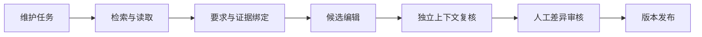

# DocChange

面向软件文档维护的证据驱动智能体工作台。系统检索实现与文档依据，生成可审查的修改提案，并通过版本校验和人工审批发布新版本。

## 工作流程

任务提交 → 依据检索与读取 → 维护要求整理 → 修改提案 → 独立上下文复核 → 差异审核 → 版本发布。



任务、证据和编辑操作建立显式关联。Git适配器按需读取仓库并导出候选补丁；工作台通过Revision与ChangeSet保存文档历史和发布记录。

仓库Agent新增`taskgraph-v2`：Planner生成带查询与依赖的维护计划，运行时自动搜索/批读，再进行覆盖判断、候选编辑和结构化复核；最多一次限定需求/路径的修补。任务、原文证据、覆盖格、编辑及复核可导出为关系图。实现范围与借鉴来源见[任务图设计](docs/design/23-TaskGraph与证据关系维护策略.md)，本轮[工程验收](docs/evaluation/docchange-taskgraph-2026-11-17.md)与历史模型成绩分别记录。

仓库 CLI 现默认使用 `batched-react-v1`。模型按批次提出调查问题，运行时搜索和批读，之后由模型根据新观察决定补查、编辑或结束。候选经过独立复核和 Git 校验后交由人工审批。见[现行仓库架构](docs/design/25-Batched-ReAct仓库维护架构.md)。

阶段使用独立输出协议，格式纠错计入原模型预算；搜索按根目录隔离锁，SQLite 短事务、心跳异常及恢复截止时间经过专项检查。图用于证据溯源与审计。[协议与稳定性边界](docs/design/24-TaskGraph阶段协议与运行稳定性.md)及[本轮检查记录](docs/evaluation/taskgraph-hardening-2026-11-17.md)。

## 系统设计

- 单智能体Runtime/Harness：结构化工具调用、参数校验、调用预算、持久checkpoint与工具回执。
- 版本化编辑：精确范围修改、内容hash绑定审批、版本冲突检查和可回溯发布。
- 异步执行：FastAPI、SQL Outbox、Redis Streams及独立worker；幂等与Lease/Fencing约束重复执行和过期任务。
- 检索：BM25、BGE Dense、RRF和交叉编码器重排；索引按工作区、版本与内容隔离。

## 评测

| 任务 | 范围 | 结果 |
|---|---|---|
| SciFact检索 | 完整test，300查询 | Dense Recall@10：87.42% |
| SCIDOCS检索 | 完整test，1,000查询 | Dense Recall@10：22.94%，相对BM25提高48.70% |
| DoGBench仓库定位 | 110项具有适用路径标签的任务 | Recall@10：60.88% → 69.10% |
| DoGBench文档维护基线 | 175项公开dev任务 | 导出73份通过git apply --check的候选补丁 |
| DoGBench编排对照 | 固定49题，Flash非思考 | 同10次决策上限，方向正确率22.45% → 51.02%，平均决策9.43 → 4.98次；新版26份补丁通过应用检查 |

检索召回、路径定位、补丁可应用性和修改语义质量采用独立指标。四种检索配置的逐题结果、配对区间和候选补丁见评测报告。

- [公开检索对照](docs/evaluation/docchange-retrieval-improvement-2026-11-03.md)
- [仓库定位评测](docs/evaluation/repository-localization-2026-11-03.md)
- [文档维护基线](docs/evaluation/docchange-public-2026-11-02.md)
- [49题运行配置对照](docs/evaluation/docchange-flash-comparison-2026-11-04.md)
- [批量ReAct的49题历史与同预算对照](docs/evaluation/docchange-batched-comparison-2026-11-18.md)
- [复现说明](docs/PUBLIC_BENCHMARK_RUNBOOK.md)

## 本地运行

需要Python 3.12、Node.js及pnpm。在仓库根目录执行：

```powershell
python -m venv .venv
.\.venv\Scripts\python.exe -m pip install -c requirements-dev.lock -e ".[dev]"
pnpm --dir frontend install --frozen-lockfile
pnpm --dir frontend build
.\.venv\Scripts\python.exe -m scripts.run_docchange
```

打开`http://127.0.0.1:8011`，使用本地演示账号`alice`及演示码`docs-local-2026`。演示模式使用确定性控制器，真实模型接入及部署配置见[使用说明](docs/DOCCHANGE.md)。演示凭据仅用于本机。

技术栈：Python、FastAPI、SQLAlchemy、MySQL/SQLite、Redis Streams、React、BGE、ONNX Runtime、Git。
