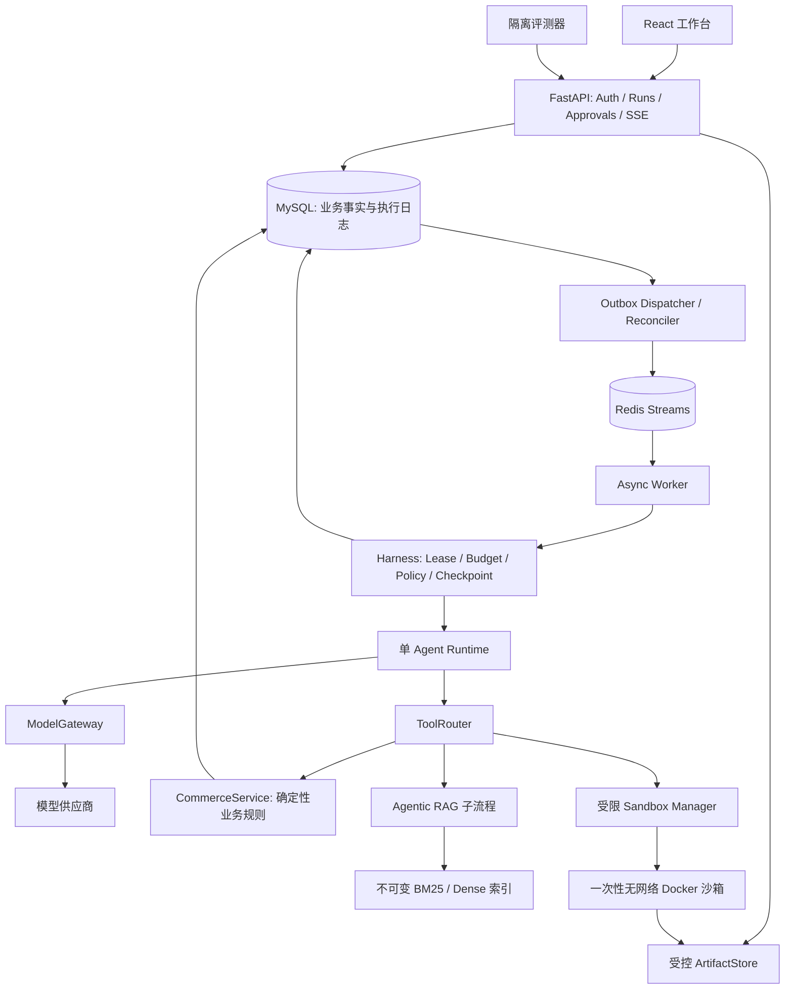

# ShopResolve：电商售后与订单异常处理 Agent

日期：2026-10-27。状态：设计规格，尚未实现、未跑实验。本文是新电商项目的唯一主规格；旧 00–09 文档保留作历史参考，冲突时以本文及配套 11 实施任务书为准。所有配置数值为工程起点，不是实测成绩或行业标准。

选型确认（2026-10-27）：用户明确保留自写 Runtime/Harness + MySQL 原方案；讨论中提出的 LangGraph/PostgreSQL 替换建议未采用。`13-ShopResolve可靠执行协议与故障验收.md` 是本文的必读可靠性细化规范，补充事务边界、恢复判据和故障测试；实现时三份文档 10、11、13 一并执行。当前没有任何可靠性实测结果。

补充规范：`14-ShopResolve记忆意图与Loop控制规范.md` 定义本期单 Agent 决策、Memory、IntentFrame/目标变更、CompletionGuard、ProgressMonitor 及验收。实施必读 10、11、13、14；其中 14 对 run.status 与业务 outcome 的区分是主规格的明确细化，不得仅用 SUCCEEDED 计算业务任务成功率。本期不实现 Multi-Agent 或跨会话长期画像。

## 1. 项目定位与业务闭环

目标用户：电商平台售后客服及消费者。解决“订单事实、政策说明和用户意图分散，跨多轮确认容易漏条件，重复操作容易造成重复退款/建单”的问题。

项目不是通用聊天机器人，也不是完整商城。核心是：**查事实 → 找适用政策 → 形成可执行方案 → 获取明确授权 → 修改模拟业务状态 → 回读验证 → 给出带依据的结果**。

真实业务动机不等于真实企业落地。默认数据、订单、用户、政策均为有版本的合成场景；所有金额和退款均在模拟账本中，不接支付网关、不接真实商家后台。README 和简历必须注明这一点。

### 1.1 场景优先级

| 优先级 | 场景 | Agent 必须完成的任务 | 客观验收 |
|---|---|---|---|
| P0 | 已收货商品退货退款申请 | 核验订单归属、收货时间、品类例外、可退数量；引用政策；确认后创建退货申请 | 唯一申请、金额正确、授权完整；此阶段不得声称退款到账 |
| P0 | 待发货订单取消 | 查当前状态、说明影响、确认后取消并生成模拟退款记录 | 取消与模拟账本原子一致；已发货不可取消 |
| P0 | 物流异常 | 查物流事件和政策；补问缺失信息；创建人工处理工单 | 不虚构预计送达时间、不把“延迟”直接等同可退款 |
| P1 | 换货/替代品建议 | 查库存与规格约束、比对政策；输出候选并确认 | 不推荐不满足硬约束商品；换货执行仍经业务规则校验 |
| P1 | 上传商品对比 CSV | 在隔离环境做规格/价格计算，结合商品资料解释结果 | 数值与参考程序一致；文件不越权、不外传 |

默认不做：自动下单、自动付款、真实退款、任意联网爬虫、广告推荐训练、多店铺运营平台、RL 训练、Kubernetes、通用浏览器 Agent。后训练是另一个项目，本项目仅导出脱敏轨迹。

### 1.2 典型演示

用户：“耳机昨天收到了，一边没声音，想退；另外另一个订单还没发，能一起取消吗？”

系统先查两笔订单归属和状态；并行读取独立政策与物流；必要时追问商品/数量。第一笔生成退货申请提案，第二笔生成取消提案，分别展示金额、影响、有效期。用户明确选择后逐个执行；第二笔若已发货则拒绝旧提案，重新解释。界面展示最终业务状态和政策原文，不展示私有思维链。

## 2. 架构选择：一个循环，不叠加多个框架

**采用 FastAPI + Pydantic + 自写轻量类型化 Runtime + MySQL + Redis Streams。**模型端通过可替换 ModelGateway 做一次请求；本项目拥有唯一的 Agent 循环。初版直接使用选定供应商 SDK，不引入 Pydantic AI 的 Agent.run 循环。

选择原因：保留用户已接触的 MySQL；本项目的状态主要是订单、授权和工具执行，业务事务比通用图结构更关键。实现一个固定状态机比同时引入图运行时、独立检查点数据库及第二套工具循环更便于理解和验收。代价是必须自行实现检查点、租约、恢复和副作用幂等；未通过故障测试不得宣称可靠执行。

| 候选/参考 | 取舍 | 本项目对应部分 |
|---|---|---|
| LangChain | 不作为主框架；未来可采用独立适配器，不引入隐藏循环 | Provider、Retriever 为自有接口 |
| LangGraph | 是合理备选，但本版不依赖；若未来迁移必须以 ADR 替换 Runtime，不能再套一层 | 显式状态、持久化、暂停/恢复的设计思想；业务幂等仍由本系统承担 |
| Pi | 借鉴分层，不直接依赖其 TypeScript 工具包 | 模型消息、业务事件、工具定义与循环分离；紧凑上下文 |
| mini-SWE-agent | 借鉴小而可测的 Agent/Model/Environment 边界 | Runtime、Gateway、ExecutionEnvironment 三个接口 |
| SWE-agent | 借鉴面向 Agent 的工具界面 | 结构化结果、可恢复错误、分页截断、明确观察结果 |
| Claude Code | 仅参考公开说明，不声称复刻私有源码 | 执行前权限、沙箱边界、上下文预算、可追溯工具操作 |
| Pydantic AI | 借鉴类型化工具与输出设计；本版只依赖 Pydantic | Input/Output schema、依赖注入、结构化校验 |

这不是“自研比 LangGraph 更高级”。若用户优先学习 LangGraph，可在实现前改用其状态图与持久 checkpointer，但须单独评估兼容版本与数据库，不把内存 checkpointer 当可靠方案。当前执行者不可自行换栈。

本次用户已明确不走该替换路线。自研范围仅限本业务需要的类型化循环、上下文装配、工具调度、检查点和恢复协议；不重写 HTTP 服务器、数据库驱动、容器运行时或通用分布式工作流平台。CI 指持续集成的质量门禁，不是另一种 Agent 架构。单 Agent 不等于单请求或单 Worker；可通过 worker 池处理多个彼此独立的会话。

## 3. 系统分层与服务拓扑



逻辑模块不是独立微服务。API、worker、dispatcher/reconciler、sandbox-manager 为同一仓库中的不同进程；CommerceService 初版为受事务保护的 Python 模块，未来可换远程业务适配器。

### 3.1 技术栈

- Python 3.12、FastAPI、Pydantic v2、SQLAlchemy async、Alembic、兼容 MySQL 的异步驱动、HTTPX、pytest。
- MySQL 8 兼容版本是唯一权威状态源。Redis 负责任务通知、短期缓存和限流，不保存唯一审批记录或唯一订单状态。
- Redis Streams + consumer groups；不使用 FastAPI BackgroundTasks 执行必须恢复的 Agent 长任务。
- BM25 + 本地不可变 dense 索引；第一阶段不加 Elasticsearch、Qdrant、Milvus 三套基础设施。接口预留向量库后端，达到实测容量瓶颈再迁移。
- Embedding/reranker 用可配置适配器；可测试 BGE-M3/BGE reranker 或更小模型，先测实际机器内存和速度。默认可用 API 或 CPU 小模型，不强制租 GPU。
- React + TypeScript + Vite，轻量单页；不做商城首页和复杂营销组件。
- Docker Compose 编排基础服务；pytest + Ruff + 类型检查 + GitHub Actions。精确依赖、镜像版本和模型 revision 在实施阶段锁定，禁止 latest 作为发布配置。

### 3.2 模块依赖约束

Runtime 不直接 SQL、不创建 Docker 容器；只调用 ToolRouter 与状态存储接口。工具不调用模型。CommerceService 不依赖 Agent，不信任模型计算的金额。Retriever 不自行写订单。前端不持有模型密钥。Evaluator 持有预期结果但不把它放进 Agent 工作目录。

## 4. Agent、Harness 和业务规则分别做什么

- **Agent loop**：读取当前用户目标、调用模型、选择已授权工具、观察反馈、补问或结束。
- **Harness**：围绕循环的执行设施——身份、限额、上下文装配、工具路由、检查点、恢复、停止条件、事件记录、评测接口。
- **业务规则引擎**：金额、订单状态、退货期限、品类例外、库存、用户权限。由普通代码和结构化政策表决定，不能交给模型最终裁定。

初版只有一个有状态对话 Agent；RAG 是受预算约束的子流程，不是另一个自由 Agent；验证器主要是代码，不再增加“反思 Agent”“裁判 Agent”来制造多 Agent 名称。

### 4.1 Runtime 状态机

```text
QUEUED -> RUNNING -> WAITING_USER -> QUEUED
                  -> WAITING_APPROVAL -> QUEUED
                  -> SUCCEEDED / FAILED / CANCELLED / EXPIRED
```

单次运行内部：load_context → model_step → validate_decision → execute_read_tools / prepare_action / ask_user / finalize → persist_observation → 再次 model_step。

- AgentDecision 判别联合：ToolCalls、AskUser、ProposeAction、FinalAnswer。字段缺失/非法工具一律拒绝；有限格式修复后失败，不无限重试。
- model_step 的完整响应先持久化，再执行工具。所有 tool_call_id 与结果严格配对；同批结果按模型调用顺序回填。
- write 工具不能与 read 工具混为一个任意并行批次。任何写操作都先转换为持久 Proposal，经用户审批后执行。
- 无证据、超预算、缺必要信息时，结束为部分结果或转人工；不能把拒绝/转人工统一记作任务成功。
- 默认起始限额：12 次模型调用、2 次检索改写、4 个并发只读工具、单 run 120 秒活跃执行预算。人工等待不占活跃预算，另设 24 小时等待过期时间。均可配置并进入评测配置哈希。

### 4.2 上下文与记忆

上下文按优先级组成：固定系统规范 → 当前身份的最小权限描述 → 当前任务/待确认项 → 最近必要对话 → 结构化订单快照 → 相关 Evidence → 工具结果摘要。

完整事件日志和模型原始响应分开存。长文本存 artifact，仅注入摘要和引用；不得压缩掉金额、订单版本、政策版本、审批摘要和待执行 operation_id。摘要不是业务事实源；每次写前重查数据库。

跨会话偏好不是 MVP 必需。若做，用户可查看/删除，按 owner 隔离；不得把“上次同意退款”视作本次授权。检索内容、CSV 和工具返回文本始终为不可信数据，不能覆盖系统规范。

### 4.3 本期必须实现的控制组件

按补充规范 14 实现 IntentFrame（多意图、咨询/动作区分、来源引用）、EntityResolver、TaskGoal/SlotValue、ContextBuilder 的摘要版本管理、CompletionGuard 和 ProgressMonitor。单 Agent 负责提议，程序负责验证；模型不能自行写审批、verified 槽位或任务终态。等待态目标修改通过版本化 revisions 接口，运行态不做实时 steering。多目标必须分别记录结果。

## 5. 工具契约和权限

通用 ToolResult：status、summary、data、evidence_refs、artifact_refs、error_code、retryable、truncated、observed_at。通用 ToolSpec：name、input_schema、output_schema、effect(read/propose/write/sandbox)、timeout、parallel_safe、required_role。

| 工具 | 作用 | 强制限制 |
|---|---|---|
| get_order / list_orders | 读取当前用户订单 | owner 从服务端身份注入，模型不得提供任意 owner |
| get_shipment | 读取物流快照 | 校验订单归属；返回数据时间 |
| search_products / get_product | 查结构化商品/库存 | 当前价格库存必须读库，不从向量片段推断 |
| search_policy / read_policy_section | 检索并展开政策条款 | 生效时间、品类、租户、政策版本过滤 |
| calculate_eligibility | 返回可用售后动作和约束 | 确定性规则；不能仅凭 LLM 自报 eligibility |
| prepare_action | 创建不可变 Proposal | 无业务副作用；生成规范化参数哈希 |
| execute_approved_action | 执行已审批模拟动作 | 内部受控入口；不暴露任意参数给模型 |
| get_operation_status | 回查操作结果 | 超时后先查此工具，禁止直接生成新退款 |
| analyze_comparison_csv | 运行隔离分析任务 | 输入仅经授权 artifact；无网络无订单库权限 |
| create_escalation_proposal | 提议转人工工单 | 最小信息、同样去重；执行需授权 |

模型不能调用 SQL、宿主 shell、Docker CLI、任意 URL fetch。客服演示账号也有角色范围，不能因为是 agent 就自动获得管理员权限。

## 6. 业务领域模型、数据库与不变量

所有金额存整数分 + currency，不用浮点数。UTC 时间、显示层转换时区；场景评测用固定 clock。ID 为不透明 UUID。所有可修改业务对象带 version。

### 6.1 核心表

| 表 | 必需字段/约束 |
|---|---|
| users / sessions | user_id、role、tenant_id；会话 token 哈希、有效期；初版用本地演示登录，不设计公网注册 |
| conversations / messages | owner_id、conversation_id、message_id、role、body_ref、created_at；消息请求去重 |
| orders / order_items | owner_id、status、currency、version、placed_at、delivered_at；item 的 paid_amount、quantity、returned_quantity |
| products / inventory / shipments | sku、规格、price、stock、version；物流事件与来源时间 |
| policy_versions / rule_configs | effective_from/to、category、region、content_hash、结构化规则及文档关联 |
| returns / refunds / tickets | operation_id 唯一、order_id、金额/数量、状态、policy_version；退款为模拟账本 |
| runs | owner_id、conversation_id、status、state_version、lease_owner、lease_until、fencing_token、budget_used、deadline、config_hash |
| model_calls / tool_invocations | run_id、step_seq、logical_call_id、args_hash、status、attempt、result_ref、usage；logical_call_id 唯一 |
| checkpoints | unique(run_id,step_seq)、schema_version、state_ref、pending_invocations、budget_snapshot；状态引用不可变 |
| proposals / approvals | operation_id、action_type、args_hash、order_version、policy_version、expires_at、decision、decided_by；审批只针对单一提案 |
| operations | operation_id 唯一、proposal_id 唯一、status、request_hash、result_ref；业务操作最终凭据 |
| idempotency_records | unique(owner_id,route,key)、body_hash、resource_id、response_status；同 key 不同请求返回冲突 |
| events | unique(run_id,seq)、type、payload、created_at；与关键状态同事务提交 |
| outbox | event_id 唯一、aggregate_id、kind、payload、published_at、attempt；只存资源 ID 和版本，不复制敏感长文本 |
| documents / chunks / evidence | 文档版本、父子 chunk、权限元数据、locator、内容哈希；证据能定位原文 |
| artifacts | owner_id、run_id、storage_key、sha256、mime、size；路径服务端生成 |
| eval_runs / eval_results | dataset/split/config/model/seed、检查结果、成本和轨迹引用；隔离评测库 |

主要索引：runs(status,lease_until)、events(run_id,seq)、outbox(published_at,id)、orders(owner_id,id)、proposals(owner_id,status,expires_at)。通过 EXPLAIN 与数据量实验验证，不在简历虚构“索引优化 90%”。

### 6.2 业务规则

- 退款累计金额不能超过实际已付且未退金额；退货累计数量不超过可退数量。
- 订单只能走定义的状态迁移；已发货不能执行“待发货取消”。
- 退货申请成功 ≠ 商品已收回 ≠ 退款成功。MVP 只自动创建退货申请；后续确认收货由测试 fixture/客服模拟事件驱动。
- 取消待发货订单与该操作的模拟退款账本在同一 MySQL 事务提交。
- 硬规则取自 policy_version 对应的结构化规则配置；文档用于解释和检索。两者来源相同版本包；不一致时停止该动作并上报，不让 Agent 自行选宽松版本。
- 同一资源并发修改用行锁/乐观 version 校验；使用确定锁顺序，短事务内禁止模型/HTTP 调用。

## 7. 幂等、审批和恢复：必须实现的执行语义

**投递是 at-least-once，业务结果靠幂等和事务防重复；不声称整个分布式系统 exactly-once。**

### 7.1 HTTP 请求幂等

所有创建 run、提交消息、决策审批接口要求 Idempotency-Key。鉴权后对规范化请求体计算哈希；在数据库事务中插入唯一键并创建资源/响应凭据。同 key 同 body 返回原 resource；不同 body 返回 409。进程崩溃前事务回滚即可重试，已提交则读取原记录。

请求幂等不能防用户用新 key 重复发同一指令，因此业务层仍需要订单状态/金额校验和稳定 operation_id。不得仅以“order_id+action_type”永久去重，避免阻止合法的第二次部分退货；operation_id 标识一次经确认的具体意图，数量和金额不可变。

### 7.2 提案和确认

Proposal 包含动作、订单/商品、金额、政策版本、订单版本、参数哈希、有效期和用户可读影响。API 从身份获取审批人；客户端传回 proposal_id、approve/reject、expected_version，不接受任意替换参数。

审批事务持久化 decision，并写恢复任务 outbox。执行时再次检查身份、有效期、参数哈希、订单 version 与 policy_version。如果价格、订单状态或适用政策变化，标记 STALE，要求新提案和重新确认，不能把旧批准搬到新动作。

审批与实际执行分离，等待不占 worker。拒绝记录进入上下文；除非用户提出新意图，否则不得反复请求同一批准。

### 7.3 Worker 租约与 fencing

消费 Stream 消息后，在 MySQL 原子认领 run，增加 fencing_token 并设置 lease_until。后续 checkpoint、事件提交、业务写事务均验证当前 token、状态和租约；旧 worker 失去租约不得提交。

写操作事务锁定 run 和目标订单行，检查 fencing 与未取消状态，再查询/创建 operation、更新业务及事件，统一提交。租约只阻止陈旧 worker 提交，不取消已经发出的模型请求；可能重复的模型费用要如实记录。

初始租约 30 秒、10 秒心跳仅为配置起点。暂停/结束必须释放租约；数据库时钟用于租约判定，避免不同进程时钟漂移。一个 conversation 同时只允许一个非终态 run（等待态也算）；用户新消息用于显式恢复/取消，不能悄悄并发修改同一上下文。

### 7.4 Outbox / Redis / Reconciler

API 在单个 DB 事务创建 run、event、outbox；dispatcher 发布 Redis 后再标记 published。发布后崩溃可能导致重复通知，由 worker 认领与版本校验消除。

Worker 只有在处理结果持久化为终态、等待态或可恢复检查点后才 ACK。pending 超时回收采用 consumer-group 机制；仍需 DB reconciler 扫描过期 RUNNING、长期 QUEUED 和待发布 outbox。Redis 清空/重启后以 DB 未完成任务重建通知，不把“已发布”误认为“已执行”。

### 7.5 外部副作用与未知结果

当前模拟 CommerceService 与 operations 共用 DB，保证事务提交与结果凭据一致。未来接真实远程业务 API 时必须传下游 idempotency key，并具备状态查询。下游不支持时，网络超时后状态为 UNKNOWN，停止自动重发并人工核对。数据库事务无法回滚真实外部转账。

| 故障点 | 预期恢复 |
|---|---|
| API 提交后未发 Redis | outbox 补发 |
| 同一任务投递两次 | 仅当前合法 lease 执行 |
| 模型完成后未保存 | 允许重新请求，计费可能重复；尚无业务副作用 |
| 工具/退款事务成功后 worker 崩溃 | 相同 operation_id 回读结果，不再次修改账本 |
| 审批等待时服务重启 | DB 恢复等待态，不重新批准 |
| 旧 worker 在新 worker 后返回 | fencing 拒绝提交 |
| 用户取消与执行竞态 | 以 run/订单事务锁定顺序线性化；已提交结果保留并展示，不宣称撤销已完成动作 |

## 8. 异步、限流、SSE 和可观测性

API 不等待完整 Agent 结果，创建返回 202 + run_id。Worker 用 asyncio 执行模型/HTTP/数据库 I/O；HTTPX 与 DB 连接池复用。独立只读工具可通过 TaskGroup + semaphore 并发，每个任务使用独立数据库 session；禁止共享一个 AsyncSession 并发操作。

CPU 密集 embedding、rerank、CSV 解析放入独立进程/沙箱，不在事件循环里直接运行。取消传播到尚未完成的 I/O 和沙箱任务；已提交业务不能靠 cancel 逆转。非幂等写不因一般超时自动重试。

起始并发为 2 个 active runs、每 run 4 个只读工具、全局 1 个沙箱；LLM provider 单独 semaphore 和 RPM/token 预算，限制队列长度。重试只针对允许的错误，指数退避加抖动，有总时限。Redis Lua 实现用户级 token bucket；队列满返回 429/503。Redis 故障时新任务可拒绝以限载，DB 已接收任务由恢复机制处理。

SSE：GET /v1/runs/{id}/events，鉴权并检查 owner。事件 id=持久 seq；Last-Event-ID 续传。Redis pub/sub 若使用仅作唤醒，丢失后回 MySQL 拉取。心跳不是业务事件；过旧 cursor 返回可恢复提示与 snapshot 地址，不假装完整回放。

模型 token 流仅为临时草稿；可靠事件保存完整步骤结果和最终回答。不要把“已退款”等草稿提前作为成功状态。浏览器断开不取消任务。前端用支持 Authorization 的 fetch SSE parser；不把 token 放 URL。

日志字段：trace_id/run_id/operation_id/step/tool/attempt/duration/error_code。记录队列时延、模型/工具耗时、token 与估算费用、恢复次数、审批等待、拒绝原因。缺失 usage 标为 unknown，不能算零成本。脱敏订单地址/电话，不记录 token 和凭证。可后加 OpenTelemetry；不要求购买观测 SaaS。

## 9. Agentic RAG：决定查什么，而非让检索决定权限

### 9.1 数据分工

- **结构化实时事实**：订单、价格、库存、物流状态走业务工具。
- **解释性知识**：售后政策、品类例外、配送条款、商品说明进入 RAG。
- **硬规则**：结构化且有版本的规则引擎最终判定；RAG 原文不授予业务权限。

### 9.2 离线管线

政策包/商品说明 → 格式校验和版本登记 → 按标题/条款切 parent → 切 child → 保存 locator/适用条件 → BM25 与 dense 索引 → 快照哈希 → 原子切换索引版本。

初始 child 200–400 token、父节不超过约 1200 token，需按数据调参。保留文档版本、生效区间、店铺/品类/地区、父节 ID 和内容哈希。规则包和文档快照一同发布；过期版本仍保留供审计。初版仅可信管理员导入 Markdown/JSON/纯文本，不开放任意网页/PDF导入。

### 9.3 在线子流程

1. 解析查询所需槽位（动作、品类、收货时间、地区）。缺少关键条件先补问或查订单。
2. 先做权限/有效期/品类过滤，再 BM25 + dense 各召回候选；RRF 合并去重。
3. rerank → 取 child 命中 → 展开 parent 中相关条款和例外；按 token 预算去重装配。
4. 生成 Evidence 包：source_version、section locator、quote、hash；核验出处可访问、版本适用。
5. 信息不足时允许最多两次明确目的的查询改写或展开；无法解决则报告缺口/转人工。

Agent 可选择不检索（只查物流）、单次检索或补充检索。这才是本项目 Agentic RAG 的区别；BM25、dense、rerank、父子分块仍是底座，不因加 Agent 就消失。

起始候选 BM25 20 + dense 20，rerank 最多 30，最终上下文最多 6 段；只是实验起点。开发集比较 top-k=3/6/10、RRF/单路、rerank on/off；按成功率—成本曲线选配置。reranker 分数不是普适可信度概率，拒答阈值须通过开发集校准。

引用验证分两层：确定性检查版本/locator/hash；语义支持由小样本人审为主，LLM judge 辅助且报告一致性。不能把“有引用”自动记成“回答有证据”。

## 10. 沙箱：有明确任务，不为堆技术加入万能 shell

核心售后查单、审批不需要执行任意代码。沙箱用于 P1 商品对比 CSV 的有限计算：单位归一、总价比较、规格筛选，输出 JSON/CSV 和计算脚本。Agent 生成的脚本是不可信程序；CSV 的文字也可能包含提示注入。

SandboxManager 提供 submit/status/cancel/artifacts 受限接口；只接收服务器 artifact_id、代码内容和已定义资源 profile，不接收客户端 Docker flags、宿主路径或镜像名称。初版仅预构建可信 Python 分析镜像，不允许运行时 pip install。

隔离要求：非 root 用户、network=none、read-only 根目录、cap_drop=ALL、no-new-privileges、默认 seccomp、PID/CPU/内存/墙钟限额、独立临时 workspace。输入只读挂载；输出限定目录；不挂载仓库、Docker socket、宿主凭证、模型 key、MySQL/Redis 网络。

初始配额：1 CPU、512MiB、64 PIDs、20 秒、输入 2MiB/10000 行、输出 5MiB、日志 64KiB。不是安全保证或性能承诺；超限返回结构化错误。限制 CSV 列数/单元格长度，拒绝二进制与压缩包；导出 CSV 对公式前缀做安全处理。

输出由 manager 校验 regular file、路径、符号链接、大小、类型、sha256，再复制到授权 ArtifactStore；容器结束后回收。孤儿容器通过标签 run_id + TTL 清理，不能删除其他容器。执行者不得清理用户现有 Docker 数据。

Docker manager 本身具有高权限：API/Worker 不挂 Docker socket，manager 仅内部受认证入口，不暴露公网。优先独立/rootless runner；开发用 WSL2 的独立 Linux 环境。普通 Docker 共享内核，不是对恶意公网多租户代码的强安全边界；本版本只做本地可信使用者演示。若公网开放任意代码，需先采用 gVisor/微虚机等更强隔离并重新审计。

正确性边界：沙箱输出只用于商品建议，不参与退款金额和业务权限判定。用户无需上传真实个人数据。

## 11. API 与前端

### 11.1 HTTP 契约

| 方法/路径 | 输入/行为 |
|---|---|
| POST /v1/demo-sessions | 本地演示角色登录，返回短期 bearer；线上模式禁用默认账号 |
| POST /v1/conversations | 创建当前 owner 会话 |
| POST /v1/conversations/{id}/messages | text、attachment_ids、client_message_id；幂等；创建或恢复 run |
| GET /v1/runs/{id} | 状态、预算摘要、待补问信息、proposal 摘要、最终结果 |
| GET /v1/runs/{id}/events | SSE 续传，owner 校验 |
| POST /v1/runs/{id}/cancel | 幂等取消请求；说明已完成副作用不会回滚 |
| GET /v1/proposals/{id} | 展示不可变提案及影响 |
| POST /v1/proposals/{id}/decision | approve/reject、expected_version；身份服务端注入 |
| GET /v1/orders/{id} | 仅当前用户或授权客服范围 |
| POST /v1/artifacts | 限定 CSV 上传，先写隔离存储；不任意本地路径 |
| GET /v1/artifacts/{id} | owner 校验下载、正确 MIME、attachment header |
| GET /v1/evidence/{id} | 授权原文定位，不泄漏未授权政策 |
| GET /health/live 与 /health/ready | 存活和依赖就绪区分 |

响应错误统一 error_code/message/retryable/trace_id。无权访问资源统一 404，避免枚举。422 参数错误、409 幂等/版本冲突、429 限流、503 依赖不可用。审批需要有效身份而非模型文本中的“用户已同意”。

### 11.2 最小前端必须做，但放在后端闭环之后

一个工作台包含：会话/任务列表、对话区、订单卡片、政策引用抽屉、操作确认卡、执行时间线、结果/附件区。客户和客服演示视图复用页面，后端角色权限不靠前端隐藏按钮。

展示：“读取订单”“核验政策”“等待你确认”“操作成功/过期”等可审计事件，不展示或伪造模型私有思维链。引用可点击定位；审批按钮展示金额、对象和影响；SSE 断线可恢复，刷新页面不丢任务。

只做这一页和必要登录，不做完整购物车/结算商城。前端的价值是面试演示可理解、错误与授权可见，而非 UI 页面数量。

## 12. 评测设计：任务结果而非聊天好不好听

借鉴 τ-bench 的工具—用户—政策交互和最终业务状态检查，但本项目是自建场景集，**不得标称官方 τ-bench 成绩**。若将来复用官方数据，要独立遵守许可、保持官方协议并单列结果。

### 12.1 数据集

最小 CI 集 20 个确定性 case；开发集建议 40 个、冻结测试集建议 60 个，按场景族和政策模板切分，不能同模板换订单号就跨 split。初版规模小，必须报告数量、覆盖和不确定性，不假装行业代表性。

覆盖：正常售后、多商品部分退货、已发货取消、过期政策、品类例外、缺信息、用户拒绝、版本过期、库存变化、越权、提示注入、重复请求、worker 崩溃、Redis 重启、CSV 计算/恶意输入。冻结数据有 dataset_version、seed、clock、政策和初始 DB 快照。

脚本化用户用于 CI 和可重复实验；可选独立 LLM 用户模拟器用于补充实验，记录其模型/提示词/预算，并与脚本结果分开。它不能访问 Agent 私有状态或目标答案。每个 trial 使用独立数据库/namespace 和 session，不能沿用前一 trial 的退款状态。

### 12.2 成功判据

TaskSuccess = 正确业务目标状态 AND 无非法副作用 AND 满足必要授权/政策约束。只检查相关状态投影及不变量，不要求整库字节一致；同时检查不该变化的余额/他人订单等哨兵状态。

- 问答类：正确的事实、适用政策版本、关键证据支持；不是只查有无链接。
- 可执行类：正确 order/item/action/amount、正确审批、唯一账本效果、回读状态。
- 应拒绝类：拒绝原因与政策相符、没有副作用。
- 可解但转人工：不算自动完成；单独报告升级处理率，防止“全拒绝”刷安全分。
- 沙箱类：参考计算结果、容差、资源边界和无网络/宿主访问。

### 12.3 指标与实验

主指标：任务成功率、违规执行率（同时给攻击/写入机会分母）、重复副作用数、恢复成功率、证据支持率、检索 Recall@k、P50/P95 时延、每成功任务 token/成本。小样本报告置信区间，P95 样本不足标注不稳定。

对随机性强的 Agent，在固定场景独立重跑 k 次，报告“k 次全部成功”的可靠性（pass^k 思路），不是“k 次中有一次成功”的 pass@k。若估计官方形式的 pass^k，按原论文定义与足够重复次数实现；自建结果注明具体估计方式。

基线：A 固定 FAQ/单次 RAG + 同一安全业务层；B 单 Agent + 单次 hybrid 检索；C 完整按需多轮检索 + harness。三组尽量同模型、同工具、同数据、同预算上限；不为让完整版胜出而给基线去掉基本权限。分别报告 RAG 算法实验和故障恢复实验。

消融：BM25 only/dense only/hybrid；rerank on/off；父节展开 on/off；固定检索/按需补检索；故障注入下恢复 on/off。安全模块移除只允许隔离测试，不进演示默认配置。

LLM judge 仅辅助语言质量和支持关系，绝不代替业务状态断言。抽样人审 judge；所有失败保存类别、输入、工具结果和重现命令。

### 12.4 CI

- 每个 PR：Ruff/类型检查/单元测试、mock model Runtime、业务规则/权限、检索 fixture、OpenAPI schema、前端构建；无需付费密钥。
- 集成 job：MySQL/Redis 服务、outbox 重复投递、租约失效、审批恢复、跨 owner 拒绝、SSE 续传；runner 能力不足时显式 skipped，不能当已覆盖。
- 沙箱 job：在受控 Linux runner 跑网络、文件、超时、输出限额检查；不要在带生产密钥的 runner 执行不可信代码。
- 真模型评测：手动触发、显式预算上限、受保护 secrets；不向 fork PR 暴露 key。测试结果作为 artifact，不自动公开可能含隐私的 trace。

## 13. 部署、README 和交付物

开发建议代码放 WSL2 Linux 文件系统，避免 Windows 跨文件系统 bind mount 性能问题；不自动迁移现有目录。Compose 默认服务：mysql、redis、api、worker、dispatcher；sandbox-manager 用独立 profile；前端开发服务可独立启动，发布用静态构建。

MySQL/Redis 使用专用卷和最小账号；不复用/覆盖用户已有 MySQL 数据库。默认外部入口绑定 127.0.0.1；仅必要调试端口可显式开启。提供 .env.example，不提交密钥。迁移显式执行，seed 只作用于项目专用库；reset 必须确认且不能碰其他项目。

正式 README 必须包括：业务问题与模拟边界、架构图、技术选型/取舍、运行模式 mock/live、经过验证的启动/迁移/seed/测试命令、演示脚本、评测表与限制、安全模型、故障恢复演示、目录导航、许可证和数据来源。没有跑通的命令标 planned；没有实验的数值标未测。

其他交付物：OpenAPI、ER 图、状态机、ADR、数据卡、评测报告、威胁模型、失败案例集、演示录屏/截图、一次故障恢复记录。README 不是最后随便写的宣传页，而是可复现入口。

## 14. 推荐仓库结构（尚未创建）

```text
shopresolve/
  README.md  pyproject.toml  uv.lock  .env.example
  compose.yaml  Dockerfile
  apps/api/               # HTTP、身份、SSE
  apps/worker/            # 消费、租约、调度
  apps/dispatcher/        # outbox 与 reconciliation
  apps/sandbox_manager/   # 唯一接触执行宿主的控制进程
  src/shopresolve/
    domain/               # 订单、售后、政策状态机
    services/             # 业务事务与幂等
    agent/                # Runtime、decision、context、checkpoint
    harness/              # policy、budget、lease、events
    models/               # provider gateway / mock
    tools/                # 注册和参数校验
    retrieval/            # ingest / index / hybrid / rerank / evidence
    storage/              # repos / artifact store / outbox
    sandbox/              # adapter / profiles / validators
  migrations/
  frontend/
  data/fixtures/  data/policies/  data/manifests/
  evals/cases/  evals/runners/  evals/graders/
  tests/unit/  tests/integration/  tests/security/
  docs/adr/  docs/evaluation/  docs/threat-model.md
  scripts/                # 可重入迁移/seed/演示命令
  .github/workflows/
```

## 15. 分阶段范围与完成定义

1. **P0a 业务层**：模拟订单、规则、提案、审批、取消/退货申请事务；先不调模型。证明金额、权限、并发和幂等正确。
2. **P0b Agent 闭环**：mock Gateway → 真模型适配；单循环、多轮补问、工具日志、政策单次检索；端到端可演示。
3. **P0c 可靠执行**：outbox、worker、lease/fencing、checkpoint、SSE、取消；故障注入验证。
4. **P1a RAG 实验**：版本过滤、hybrid、rerank、父子检索、有限补检索；建立基线和消融。
5. **P1b 沙箱与 UI**：CSV 分析扩展、安全测试、React 工作台。
6. **P1c 发布**：冻结测试、真实结果、README、录屏和面试问题。

这是一项多阶段工程，不承诺一周全部完成。每阶段可验收交付；不得为赶工把可靠性和安全性写成已实现。

最终完成条件：无密钥 mock 模式可复现；至少一个真模型完整走通；所有 P0 故障用例与越权测试通过；P1 功能明确已做/未做；冻结评测可重跑；README 命令实际验证。零次测试违规只是测试集观察，不证明普遍安全。

## 16. 参考资料与归因

以下用于架构取舍，不声称项目具有论文创新；实施时记录所用版本/commit。

- Pi 官方仓库（原 badlogic/pi-mono 已重定向）：https://github.com/earendil-works/pi
- mini-SWE-agent：https://mini-swe-agent.com/latest/
- SWE-agent 架构：https://swe-agent.com/latest/background/architecture/
- Anthropic Building effective agents：https://www.anthropic.com/engineering/building-effective-agents
- Claude Code 沙箱公开介绍：https://www.anthropic.com/research/claude-code-sandboxing
- LangGraph persistence：https://docs.langchain.com/oss/python/langgraph/persistence
- LangGraph interrupts：https://docs.langchain.com/oss/python/langgraph/interrupts
- Pydantic AI 类型化 Agent：https://pydantic.dev/docs/ai/core-concepts/agent/
- τ-bench 论文：https://arxiv.org/abs/2406.12045
- τ-bench 官方代码：https://github.com/sierra-research/tau-bench
- Docker 安全边界：https://docs.docker.com/engine/security/

论文启发集中在“交互式任务 + 业务状态验证 + 多次运行可靠性”；本项目新增的故障注入、审批绑定和多版本政策测试是工程设计，不能直接包装成顶会方法或真实生产成果。
