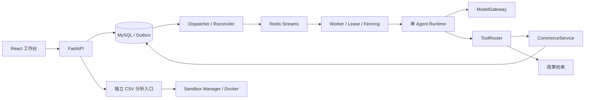
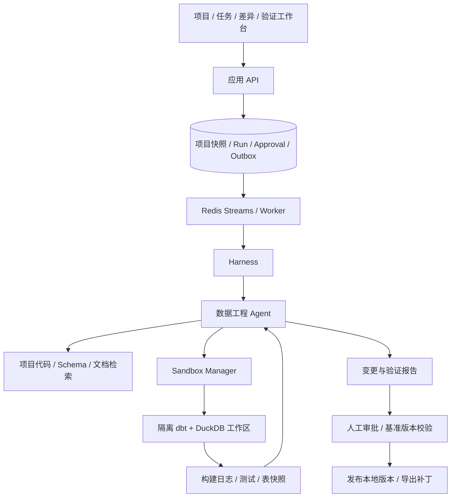
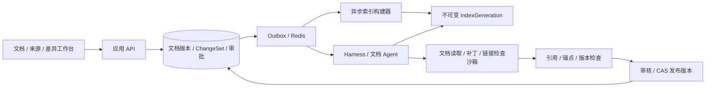
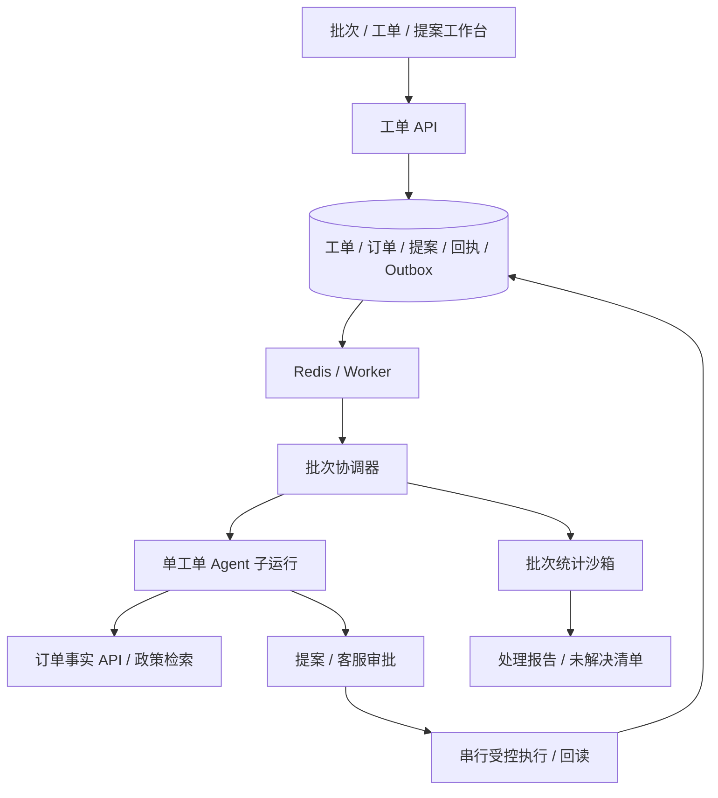
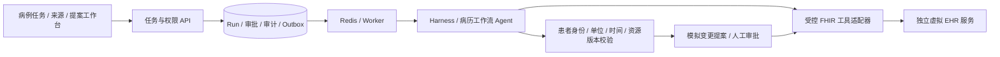

# Agent 应用重设计：四个候选方案与迁移设计

日期：2026-10-28。状态：供选型的设计提案，未实施，不替代 10/11/13/14 的现行实现约束。没有新模型调用、训练、部署或框架迁移。不得将下文目标当作已实现功能或实测结果。

## 1. 定位与建议

目标是完整 Agent 应用开发项目：有具体用户、输入、工作环境、可检查产物，有 Agent Loop/Harness、后端服务与执行环境，并用公开任务、模块消融和故障测试验证。模型选型、提示词优化、上下文管理和案例分析属于应用工程；不要求微调，更不要求为展示技术栈制造多 Agent。

推荐顺序（工程判断，不是实验评分）：

| 方案 | 具体交付物 | 公开评测贴合度 | 现有代码迁移 | 建议 |
|---|---|---|---|---|
| A 数据工程工作台 | 可执行的数据转换项目、结果表、验证报告与变更补丁 | 高：Spider 2.0-DBT 仓库级任务 | 中等；主要重做领域与沙箱工具 | 首选 |
| B 文档维护工作台 | 有来源的更新草案、版本差异、审批后新文档版本 | 组件高、完整应用低；需要独立业务任务 | 中等；主要新增文档版本与索引发布 | 偏 RAG/知识应用的备选 |
| C 售后工单处理台 | 每张工单的调查记录、处理提案、执行回执、批次报告 | 单客任务可对接 τ；批量业务需另测 | 较小，但不能把现有订单模型当工单模型 | 时间紧时的保守方案 |
| D 虚拟病历工作台 | 可追溯的病历查询结果与受控模拟资源操作 | 高：MedAgentBench 虚拟 EHR | 较大；FHIR、领域验证、独立环境 | 有医疗指导资源时考虑 |

这些公开任务支撑“任务可操作、可评测”，不自动支撑“已有真实客户愿意使用”。实际用户价值需另做任务观察、产品试用与结果审核。当前四案均不声称真实企业落地。

推荐 A 的理由是新查证的公开任务条件，而不是更换行业标签：输入是仓库与数据库，输出是代码与结果表，中间必须多步观察和执行；后端和沙箱直接服务同一交付物。它能利用用户的数据分析背景，又不把项目硬改为交易或预测系统。

## 2. 当前架构与真实边界

当前是 Python 应用、MySQL 业务状态、Redis 任务通知、自写单 Agent Runtime、React 工作台。CSV 沙箱目前是独立模块，尚未成为 Agent 自动调用工具。现有模型协议为类型化 JSON 决策，不应混称原生 function calling。政策覆盖校验包含固定条款与关键词，不是通用语义蕴含验证。

实际代码入口：`src/shopresolve/api.py`、`queue.py`、`runstore.py`、`service.py`、`agent/`、`retrieval/`、`sandbox/`。旧报告存在历史状态，设计不将旧文档中的“尚未联调”等表述当作当前事实。

已有可保留资产：模型适配器、工具 schema、调用追踪、预算账本、运行恢复、Outbox/Redis、审批绑定、版本校验、幂等、Artifact 与沙箱隔离基础。它们仍耦合当前业务，复用不等于直接复制即可工作。

已知限制：无完整生产认证与发布编排，限流/背压/provider 熔断未齐；恢复和沙箱故障矩阵未覆盖全部场景；完整 Agent 外部基准尚未跑通。已有模型自建集成绩不迁移为新业务成绩。

## 3. 共用骨架与必须变化的部分

### 3.1 默认部署选择

第一版保留 FastAPI + Python Runtime + MySQL + Redis Streams + Docker，不在业务选型同时引入 Java 重写。逻辑拆层，不先拆成大量微服务。

若明确面向 Java 后端与 AI 应用岗位，可后续采用 Spring Boot 业务控制层 + Python Runtime。Spring Boot 负责身份、业务资源、审批、发布事务；Python 负责运行循环与工具调度。每张权威表只由一个服务负责写入，禁止两个服务各自维护相同订单或审批状态。通过带版本与幂等键的 API 对接，新增跨服务失败测试。

保留 Redis Streams 为任务队列，不为了组件数量另加 RabbitMQ。Redis 不存唯一审批记录。MySQL 保存应用元数据；A 中 DuckDB 保存任务沙箱的分析数据，两者职责不同。对象存储先沿用 ArtifactStore 接口，容量与并发有实际需求时再用 S3/MinIO 适配器。

### 3.2 Agent 与 Harness

Agent Loop：读取任务与观察 → 选择下一步 → 调工具/请求澄清/提出变更 → 读取真实结果 → 修正计划 → 验证完成。

Harness：身份权限、上下文构建、模型与工具协议、预算、日志、检查点、暂停恢复、并发和取消、产物追踪、错误处理。领域完成条件由每个方案自己的验证逻辑定义。

建议共享接口（待实施）：

- `TaskSpec`：任务、输入快照、允许的工具、输出契约；不含评测答案。
- `TaskState`：目标、事实来源、待确认项、失败与产物引用；从现有订单槽位解耦。
- `ToolSpec`：schema、权限、读写副作用、重试条件、并行安全性。
- `Observation`：调用 ID、结果、版本、时间与产物 hash。
- `ChangeSet`：基准版本、补丁/操作集合、校验结果、审批状态。
- `CompletionCheck`：应用可见验证；与隐藏 benchmark grader 分离。
- `DelegateTask` / `ChildResult`：仅在需要多 Agent 时启用，含父子 run、输入版本、权限、预算与证据。

运行状态可沿用 QUEUED/RUNNING/WAITING_USER/WAITING_APPROVAL/SUCCEEDED/FAILED/CANCELLED；多 Agent 时显式增加等待子任务的机制。运行结束与业务成功分开。恢复以持久结果为准，外部操作超时先查状态，不默认重发。

### 3.3 多 Agent 共通约束

先有同模型单 Agent 基线。只有可拆分、可验证的子任务才委派；读取工具并行不冒称多 Agent。子 Agent 有自己的工具循环、私有上下文、隔离工作区和输出契约，不能共享可随意修改的黑板。

父任务拥有总预算与取消权；子任务预算预留计入总账；重试复用稳定子任务 ID；重复子结果只合并一次。父任务恢复从数据库恢复子任务关系，不重新生成全部子任务。所有共享资源变更由主流程统一合并、校验与审批。模型审阅可以提供建议，但不能代替确定性权限检查或独立 grader。

## 4. 方案 A：DataForge 数据工程任务工作台（首选，暂定名）

### 4.1 用户、任务和应用价值

用户是分析工程师或需要维护数据转换项目的分析人员。输入为任务描述、一个授权仓库快照、数据快照及项目文档。输出是 SQL/dbt 变更、可执行结果表、验证报告、代码差异与可复现运行记录。

示例：“现有项目缺少客户月度汇总模型，按文档中的统计口径补齐，运行验证，并提交变更供我审核。”这是产品示意，不伪称某条官方测试题。

Agent 的必要性来自跨文件理解、探索 schema、选择相关模型、执行后纠错；固定 ETL 调度器负责运行已知管道，不能自动理解自然语言变更需求。仍应比较单次代码生成与循环执行的增益。

首版只做一个本地 dbt/DuckDB 项目类型，不同时做实时数据接入、云数仓、生产发布或通用 BI。

### 4.2 架构

沙箱内代码修改和测试不逐步请求批准；对外发布最终变更时审批。输入数据只读挂载，输出写到隔离路径。禁网、无应用数据库凭据，不挂 Docker socket。依赖在准备阶段固定安装；失败时不能让 Agent任意联网补包。现有 CSV 沙箱需扩展，不能当成已经支持任意项目安全执行。

### 4.3 Loop 与工具

Loop：检查输入 → 明确产物契约 → 阅读项目/查 schema → 制定局部计划 → 编写补丁 → 执行 build/test → 根据报错定位 → 修复或说明阻塞 → 验证产物 → 提交差异 → 审批发布。

工具：`list_project_files`、`read_file`、`search_project`、`inspect_schema`、`preview_rows`、`apply_patch`、`run_dbt_build`、`run_dbt_tests`、`inspect_output_table`、`get_artifact`、`propose_changeset`。SQL 仅在任务专属数据库运行；外部数据源未来另做只读连接器。

RAG：检索项目说明、模型定义、字段说明和版本锁定的文档；精确名称搜索与结构化依赖图先做基线，向量检索按实测决定是否添加。不能把全部源代码一律切成通用文本块。

Memory：保留输入 commit、schema 版本、目标表、已修改文件、执行日志摘要与未解决错误。大日志存 artifact；上下文引用带偏移和 hash；压缩不得丢掉目标列与口径约束。不先做跨用户长期记忆。

多 Agent 候选：主 Agent 负责整合；独立子 Agent 调查可分离的模型/源表；候选补丁各在独立工作区生成。依赖关联的文件不并行写同一目录。独立验证器是程序，不必伪装成“评审 Agent”。

### 4.4 数据、API 与页面

新增实体：Project、ProjectSnapshot、DatasetSnapshot、TaskRun、SandboxJob、PatchSet、ValidationRun、Artifact、Approval、PublishedRevision。运行/事件/模型调用表沿用设计但解耦订单字段。

API 草案：创建项目快照、提交任务、查看事件流、查看文件差异和验证、审批 ChangeSet、导出结果。发布时检查输入版本与 patch hash，审批后项目变化则提案失效。重复发布返回同一版本回执。

页面：项目列表；任务与日志；SQL 差异；结果表预览；验证与审批。不是只给一个聊天输入框。

### 4.5 评测与来源

主公开基准为 Spider 2.0-DBT。官方提供仓库级任务，包含 68 个 dbt/DuckDB 案例；这不意味着模型 API 免费。固定具体 commit、数据 hash、grader 与依赖。先验证下载与本地运行条件，再估算完整模型成本。不要把 Snowflake 或 Lite 的成绩混到 DBT。

基线：官方 Spider-Agent 对应实现、简单同模型工具循环、我们的 Harness。模型和工具可见信息保持可比；工具接口改变时明确记录。

主指标：官方结果正确率；次指标：build/test 通过率、错误宣告完成率、成本/任务与成本/成功任务、P50/P95、调用次数。构建成功不等于业务结果正确，不能以自写测试替代官方 grader。

公开评分环境的参考实现/金标准不进入 Agent 容器。Agent 可运行公开项目测试，最终隐藏评分由隔离评测进程执行。看过答案的任务不再充作未见测试；修复案例进入开发回归，终评不边改边跑。

应用扩展另测：修改口径、审批过期、文件版本冲突、长任务恢复、多 Agent 子任务重试。消融逐项比较项目检索、结构化工作状态、恢复、委派；报告失败和成本，不预设必须提升。

### 4.6 迁移与阶段交付

保留网关/队列/状态持久化/Artifact/审批原理；替换 CommerceService 与 IntentFrame；新增仓库快照、dbt 工具、执行产物与 diff；沙箱从 CSV 单脚本升级为项目工作区。停止把旧电商成功率作为本方案证据。

交付顺序：公开任务与环境准入 → 官方或简单基线 → 单 Agent 完整任务 → 工作台提交/验证/审批 → 恢复与隔离故障实验 → 必要时委派 → 冻结评测与部署文档。若项目任务无法在可用机器和预算内运行，缩小为预声明子集并标注，或切换方案，不能只展示几个成功例。

## 5. 方案 B：DocChange 版本化文档维护工作台

### 5.1 业务闭环

目标用户为维护产品说明、操作手册和团队知识库的人。输入是授权文档仓库、指定版本的新资料和修改要求；输出为引用来源的更新提案、冲突列表、文档差异，批准后形成新版本。

示例：“根据本次发布说明更新入门文档，找出仍引用旧接口的段落，保留未受影响章节，并列出无法确定的变更。”价值在找受影响内容并安全修改，不只聊天问答。

首版只处理 Markdown/纯文本和允许列表中的代码片段，暂不做复杂 Word 排版、OCR、所有格式导入或自动公网发布。

### 5.2 架构与执行

Loop：锁定来源与目标版本 → 检索受影响段落 → 阅读上下文 → 比较新旧资料 → 生成补丁 → 检查引用、链接和范围 → 有冲突则补问 → 审批发布 → 新索引就绪后切换可检索版本。

索引先构建并校验再切换 active pointer。查询绑定明确 generation，不能组合两个版本的片段。审批记录绑定文档基准 hash；编辑冲突则重新生成差异。数据库与对象文件无法共享事务时采用 staged artifact + durable manifest + reconciler，不声称跨系统原子事务。

工具：`search_documents`、`read_section`、`compare_versions`、`apply_document_patch`、`check_links`、`verify_citation_locators`、`propose_revision`。沙箱仅用于解析、链接与代码示例检查，有必要才启用。

多 Agent：每个独立文档一个调查/起草子任务；主 Agent 管理术语、共享引用和跨文档冲突；统一发布。不按“规划/执行/反思”强拆三个角色。

### 5.3 数据、评测、迁移

核心表：Workspace、DocumentVersion、SourceSnapshot、Chunk、IndexGeneration、Citation、ChangeSet、Approval、PublishedRevision。页面包含来源与文档浏览、修改要求、diff、证据定位、冲突与审批。

公开评测：SciFact 可做证据检索组件实验；其科学领域与产品文档存在分布差异，不能当整个应用成绩。OSWorld 只有真正使用其原始桌面环境与操作接口时才能报告对应分数，不能把 API 文档工具硬称为 OSWorld 评测。

完整应用任务：从许可允许的开源文档历史版本与 release notes 构造更新任务，公开任务构建程序、选样规则和基准版本；人工审核是否可解，保留未见版本/项目为测试。已有历史 diff 是参考之一，不是唯一合法答案；文档质量需按明确量表独立审核。这是公开来源自建集，不是已有官方端到端 benchmark。

指标：引用定位正确率、过期引用率、必要修改覆盖、无关修改、冲突识别、任务完成与审批正确性。检索对照 Dense/BM25/RRF/Rerank，测 Recall@k、Hit@k、证据支持和延迟；不得只给最终数。

迁移：复用检索接口、owner 过滤、版本审批、队列和日志；重写政策条款硬编码；增加文档变更、索引发布与引用定位。此案 RAG 与后端价值清晰，但独立端到端评测建设成本高于 A。

阶段：真实文档样本与许可核验 → 文档版本和检索基线 → 单文档完整修改 → 索引一致性与审批 → 多文档任务 → 独立审核和未见任务终评。

## 6. 方案 C：CaseFlow 售后异常工单处理台

### 6.1 业务闭环

目标用户改为客服/运营人员。输入为工单批次、当前订单快照和适用政策；输出每张工单的调查记录、缺失信息、处理提案与回执，最后生成批次报告。补问通过客服审核或模拟用户对话完成，不擅自联系真实客户。

任务示例：调查一批混合售后诉求，区分可执行、缺资料、状态冲突与范围外问题；批准可执行项后处理，剩余任务保持明确未解决状态。

### 6.2 架构与 Agent

外层批次调度优先用普通代码；只有需要跨工单规划时才让主 Agent 决策。子 Agent 独立调查工单，不能共享随意可写的订单缓存。同一订单相关工单需资源分组或冲突检查，最终写操作由确定性业务层统一提交。

单工单 Loop：读诉求 → 查订单与历史 → 检索适用政策 → 补问 → 提案 → 审批 → 再验版本 → 执行 → 回读。批次统计从权威回执生成，模型只解释；统计完成不能掩盖个别工单失败。

### 6.3 数据、评测、迁移

新增 Ticket、Batch、TicketOrderLink、Assignment、ChildRun、Investigation、Escalation、BatchReport。没有人工接单系统时，转人工只生成模拟待处理记录，不声称真实客服已经接收。

公开基准：τ retail 适配器使用官方政策/工具/用户模拟器/评分。当前取消退货规则不完全相同，须用独立 domain adapter，不修改官方题目迎合现有实现。完整任务支持之前只能报告预先声明的子集。批量工单、版本竞态与恢复属于单独扩展集。

指标：官方任务成功率、重复运行稳定性、误操作/漏处理、澄清效率、调用和费用；批次加完成率、同资源冲突、重复副作用及人工处理时间。真正节省人工时间需用户实验，模型延迟不能代替人工耗时收益。

迁移：保留最多 CommerceService 与审批/事务实现；新增工单生命周期、批次与子任务、批次报告；把独立 CSV 分析接为受控统计工具。最大风险仍是缺真实工单来源，只叠合成任务可能重复原项目问题。

阶段：任务数据与公开基准适配 → 单工单基线 → 工单 UI 与业务闭环 → 批次调度 → 并发恢复 → 单/多 Agent 与规则调度对照 → 冻结评测。若无法证明批次任务必要，停留单工单而不是堆多 Agent。

## 7. 方案 D：RecordFlow 虚拟病历工作流 Agent

### 7.1 业务与边界

医疗 Agent 并非都属于后训练，也不能只凭年份断定过时。这里做虚拟电子病历工作流：根据请求检索患者记录、整理来源明确的事实，并在模拟环境中准备或执行被授权的结构化操作。不是开放式问诊产品。

MedAgentBench 提供虚拟 EHR/FHIR 环境与任务，官方代码明确是研究用途。先核实数据条款、资源可获取性、环境版本与参考 grader。当前未下载或运行，不承诺部署必然无障碍。涉及临床解释与新增临床任务的正确性需要有资质人员审核；没有此资源不扩展为诊疗建议系统。

### 7.2 架构与执行

Loop：定位明确患者与任务 → 查询相关资源 → 对齐时间和单位 → 区分已知/未知 → 生成查询结果或资源变更提案 → 验证 → 审批 → 模拟写入 → 回读。

不让模型直接 SQL 修改 EHR。应用 MySQL 保存运行审计，FHIR 服务拥有患者资源；审计表不是第二份临床事实源。API 超时后按稳定请求标识与资源查询对账，具体幂等能力先核实，不能套用本地事务假设。

RAG 初版只检索固定版本接口文档和已授权资料；结构化患者事实以 FHIR 查询为准。沙箱主要运行隔离评测环境，不为凑齐技术栈允许任意脚本处理病历。

多 Agent 不默认启用；必要时让只读子 Agent 分别整理时间段/资源类型，所有信息带患者 ID 与来源，主 Agent 统一整合，写权限不下放。

### 7.3 评测与迁移

官方 benchmark 路径保持原始协议与评分；产品路径的人工审批属于另一个设置。不能把新增审批造成的交互变化藏进官方分数。

指标：官方任务成功率；查询与动作任务分开；患者绑定错误、资源字段/时间/单位错误、未授权写入、错误完成声明、成本与延迟。模型自评不能代替患者状态或资源校验。领域安全结论不能从少量无错误样本外推。

新增实体：CaseTask、PatientScope、ResourceReference、FHIRSnapshot、ClinicalChangeSet、Validation、Approval；只保存必要引用与审计数据。复用网关/队列/审批基础，替换全部电商工具、政策规则和终态判定。

阶段：数据与环境准入 → 官方基线 → 只读病例任务 → 模拟写入与身份验证 → 产品审批 UI → 故障与权限 → 冻结官方/产品两套评测。缺领域审核资源时不推荐作为首个主项目。

## 8. 其他候选为什么暂不主推

- 电信协作故障诊断：τ² telecom 适合多轮工具协作与状态评测，但不天然需要代码沙箱和复杂 RAG；可做完整支持工作台，不应为了完整技术清单强塞模块。
- 企业办公 Agent：WorkArena 有明确 ServiceNow 任务，需相应实例访问且涉及浏览器环境；如果改为自建 API，就不是原 benchmark 条件。适合后续方向，当前增加平台接入与浏览器调试成本。
- 科研分析 Agent：ScienceAgentBench 有公开科学任务，代码执行与验证自然；领域差异大，首版不建议做“自动科学家”。可作为 A 后续跨领域泛化的独立评测，不能混报 DBT 成绩。
- 通用桌面/全能代码 Agent：任务跨度过大，先做窄应用再考虑，不靠“全能”提高项目价值。

## 9. 全流程评测方案（四案共用）

### 9.1 先固定问题与评分，再开发改进

1. 核验公开资源可用性、许可、依赖、任务与评分源码；记录 commit、镜像 digest、数据 hash。
2. 按官方划分使用数据；无开发划分则提前划分并披露，按项目/来源/模板分组避免近重复泄漏。动过提示词的任务归开发集。
3. 跑官方参考或简单可复现基线，先确定失败类型，不从现有复杂架构倒推需求。
4. 冻结任务输入、模型配置、调用预算、grader、超时与失败口径。
5. 实现一项改进，做同任务配对对照；再决定是否保留。
6. 最终跑冻结配置；错误、预算截断、环境失败分别记录，不静默剔除。环境修复后的复跑保留原尝试与成本。

### 9.2 模型选型

已有 Flash/Pro 只能作为候选，不迁移旧排序。先验证目标工具协议与输出；开发集比较同模型 Harness 和跨模型配置，记录实际返回模型 ID、推理模式、温度、上下文、输出限制、并行与重试。

建议比较两个层面：固定调用/Token 约束下的任务表现；固定费用约束下的成功率—成本关系。不同模型相同调用次数不等于相同计算成本。是否引入第三个模型由失败类型与预算决定，不先购买额度。

费用规划含 Agent、用户模拟器、LLM judge、embedding/rerank API 以及重试；离线 CPU 时间也计入延迟。先执行免费预检和预算计划，新方案没有自动沿用旧付费额度。

### 9.3 指标与消融

| 维度 | 报告内容 |
|---|---|
| 任务 | 官方成功率；子任务完成；错误宣告完成；按任务类型拆分 |
| 可靠性 | 重复试验一致性；崩溃后最终结果正确性；重复副作用；恢复耗时 |
| 效率 | 总费用、每任务费用、每成功任务费用、P50/P95、模型和工具调用 |
| RAG | Dense/BM25/融合/重排逐步对照；Recall、Hit、证据完整性、延迟 |
| Context | 不压缩/截断/摘要或结构化状态；Token 与最终成功率同时报告 |
| Multi-Agent | 同模型单 Agent/委派；总预算、并行度、成功率与冲突开销 |
| 模型协议 | 原失败率、逐层恢复率、模型兜底率、语义改变率和额外成本 |

不要求把所有实验排列组合全部跑完。先有主要对照，失败分析指向的组件才追加消融；避免用大量无关实验消耗预算。

恢复注入固定在队列重复投递、模型结果落盘后、工具提交前后、审批版本变化、子任务合并与沙箱超时等边界。分母是实际执行的适用故障案例；恢复成功要求结果正确且无额外副作用，不是仅 status=SUCCEEDED。

统计按独立任务/来源分组，不把同一道题多次运行当成多个独立样本。报告配对差异与不确定区间。公开榜单配置不一致时不直接比较名次；自建任务不冒称官方 benchmark。

### 9.4 失败分析

分类：任务理解、信息检索、工具协议、计划/循环、业务规则、上下文遗失、验证器、运行基础设施。每条失败记录原始轨迹、根因证据、修复和回归。修复后案例只说明修复效果，不回写原冻结分数。评分器修正需对所有模型统一重算并保留原结果，说明评分变化而非能力提升。

## 10. 迁移与最终交付

### 10.1 不先抽象一个万能框架

先在一个选定方案跑通纵向闭环，再从实际共性抽出 Runtime/Harness 接口。避免先耗时重写“平台底座”，也不同时实施四个方案。

现有目录的迁移判断：

| 当前模块 | 处理 |
|---|---|
| agent/gateway.py | 保留接口与日志预算，按供应商能力增加适配测试 |
| agent/runtime.py / contracts.py | 解耦电商意图与工具；新增领域插件，而非全复制 |
| agent/context.py | 保留来源与预算，换成各方案关键状态 |
| agent/evidence.py | 电商专用逻辑保留在旧域；不得当通用 verifier |
| runstore.py / queue.py | 保留可靠性机制；新增子任务需补恢复验证 |
| service.py / models.py | 旧域保留；新域独立表与迁移，不覆盖订单数据 |
| retrieval/ | 保留接口；文档格式、语言、embedding 和版本策略重新评估 |
| sandbox/ | 复用管理边界；A 必须新增项目工作区和执行限制 |
| frontend/ | 选定后才按业务交付物改造；聊天只是一个入口 |
| evals/ | 旧成绩封存；新 domain、官方 adapter、隔离 grader 独立记录 |

### 10.2 建议实施顺序与停止条件

- G0 资源准入：公开数据/环境/评分可获得且可运行；不满足则调整方案。
- G1 基线：简单 Agent 能完成有代表性的任务或明确暴露可改善问题；不能只靠演示脚本成功。
- G2 应用闭环：真实 API 提交任务、读取事件、检查产物、必要时审批发布；不依赖手动修改数据库收尾。
- G3 工程可靠性：有状态中断后正确恢复，重复消息不重复发布，访问控制与沙箱边界有证据。
- G4 改进验证：加入检索、上下文或委派后，配对实验判断收益；无收益则移除或解释取舍。
- G5 最终交付：固定环境、复现命令、可运行工作台、原始轨迹、失败报告、官方与扩展集分开、成本与限制说明。

不预先承诺成功率或“超过成熟项目”。不按组件数量验收。最终要能回答：用户给了什么任务、系统做了什么、产物如何验证、复杂设计带来了什么收益。

## 11. 来源与核验边界

以下为 2026-10-28 在线核验的一手来源；只做设计检索，未安装运行这些新环境。

- [Spider 2.0 官方项目与 DBT 设置](https://spider2-sql.github.io/)：仓库级任务与设置区分。
- [Spider2 代码仓库](https://github.com/xlang-ai/Spider2)：官方基线、任务和评测；仓库提示 Snowflake 访问存在中断，因此首选本地 DBT 路径，不假定云环境可用。
- [MedAgentBench 官方代码](https://github.com/stanfordmlgroup/MedAgentBench)：虚拟 FHIR 环境、Docker 与研究用途说明；参考评分文件另有下载链接，准入时检查。
- [τ benchmark 官方仓库](https://github.com/sierra-research/tau2-bench)：客服工具交互；版本演进中，必须固定具体版本，不混用任务集。
- [τ²-bench 论文](https://arxiv.org/abs/2506.07982)：telecom 双方工具操作与协作环境。
- [SciFact 官方代码](https://github.com/allenai/scifact)：科学声明证据检索/验证，不是文档维护端到端评分。
- [WorkArena 官方代码](https://github.com/ServiceNow/WorkArena)：ServiceNow 浏览器任务与实例访问要求。
- [ScienceAgentBench 论文](https://arxiv.org/abs/2410.05080)：科学数据分析任务，作为后续候选，不混入主评测。
- [OSWorld 原项目](https://os-world.github.io/)：桌面执行环境，与 API 文档编辑的评测条件不同。

候选业务流程、架构设计与推荐排序是本报告的工程判断，不是上述来源对我们项目的背书。
