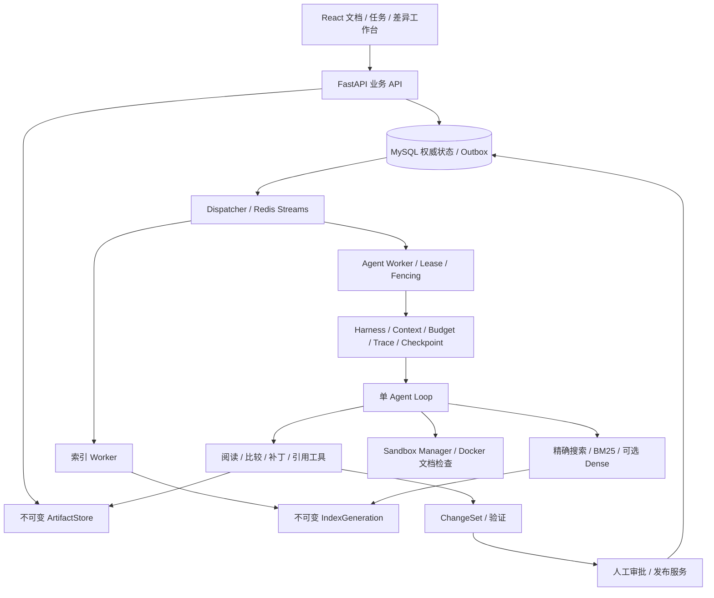

# 两项目定案与实施路线

日期：2026-10-29。依据用户要求，将申请/实习项目收敛为两个：后训练实验与 Agent 应用后端。当前是设计与免费原型阶段，不声称训练或新应用已经完成。

## 1. 决策

1. **WorkflowRepair：可验证 API 工作流修复后训练。** 源码已克隆至 `D:\证书及申请资料\WorkflowRepair`；完整研究设计见该目录 `LOCAL_PROJECT.md`。基于 DSL Debug 与 verl，新增环境、数据/验证器和奖励对照。
2. **DocChange：版本化文档工作台与可靠 Agent Harness。** 保留电商项目有价值的基础设施，业务迁移至文档。旧电商代码和结果保留作工程历史，不再并行扩展为第三项目。

不恢复“电商为主”路线：引用讨论提出的可执行环境与自动验证方法可以用于文档任务，并未提供足以推翻已选文档方向的新业务证据。两个项目分别展示“训练与受控实验”和“应用架构与可靠执行”。

旧聊天里的成绩、天数、租卡价格和“复用80%”是参考建议，不作为我们的结果或预算。简历只使用本人实际实现与复现实验数据；上游训练代码明确署名。

## 2. DocChange 业务与边界

目标用户维护 Markdown 产品文档、接口说明、操作手册。输入是授权工作区快照、新版来源资料和修改目标；输出是答案/影响分析/修改补丁、来源证据、检查报告，审批后成为可检索的新版本。

首版任务：版本限定问答、变更影响定位、单文档修改、多文档一致更新。暂不做 OCR、任意 Word 排版、无限制浏览器访问或宿主代码执行。工作台包含文档树、任务、引用、diff、检查与审批，不仅聊天框。

## 3. 后端与 Agent 架构

默认保留 Python/FastAPI、MySQL、Redis Streams，不新增框架循环或第二消息队列。若以后确实需要 Java 岗位展示，再以 ADR 迁移业务 API 至 Spring Boot；不是当前前置条件。

共享 Loop：读取任务与快照 → 选择工具 → 观察 → 更新工作状态 → 检查 → 补问或修复 → 提交 ChangeSet。Harness 负责身份、预算、调用日志、恢复和调度；发布服务负责业务状态。

新工具：search_documents、read_section、scan_exact_matches、compare_versions、create_patch、validate_patch、check_citations、run_document_checks、submit_changeset。模型没有 approve/publish 权限。

RAG 负责找到依据和候选修改位置，精确标识符使用字符串搜索，语义主题可用 Dense；“更新所有引用”必须全库扫描或关系索引，不能拿 top-k 当完整枚举。内容/版本/权限过滤在工具层强制执行。引用位置有效不等于语义支持，语义判断需另评。

## 4. 数据与一致性

- Workspace、WorkspaceMember：权限与工作区。
- Document、DocumentVersion：不可变正文、hash、路径与父版本。
- WorkspaceRevision：一组文档版本组成的不可变快照。
- IndexGeneration：绑定快照、解析/embedding 配置与完整性清单。
- ChangeSet、ValidationRun、Approval、Publication：补丁、验证、审批与发布回执。
- Runs、ModelCalls、ToolInvocations、Checkpoints、Events、Outbox、Artifacts：复用执行层概念。

Agent run 固定读取一个 WorkspaceRevision，检索返回相同快照的结果；读权限每次重新核验，权限撤销不能因快照固定而继续暴露内容。引用同时保存文档版本、段落位置和hash。

候选修改先写不可变文件，索引先构建、检查再进入 READY。发布短事务校验审批、基准revision、候选hash、索引READY后切换 active revision/generation，写回执与 outbox。新旧版本不混读。大文件/索引在事务外准备，失败由reconciler处理，不声称文件系统与数据库跨系统原子提交。

审批绑定 base revision、patch hash、validation digest 与审批身份。批准后文档变化则提案失效，不把旧批准搬到新补丁。拒绝不修改工作区。回滚通过创建/发布指向旧内容的新revision，保留审计，不删除历史。

接口族：文档导入、快照查询、创建run、SSE事件、读取changeset/diff、审批、发布状态、取消、产物下载。所有资源按owner/workspace鉴权；创建类请求使用幂等键。同key不同body冲突；稳定publication ID与唯一约束防重复发布。

## 5. 沙箱、恢复与多 Agent

沙箱用于 Markdown/链接/允许的文档构建检查。输入只读、候选目录隔离、无密钥/数据库权限/Docker socket、默认禁网、非root、CPU/内存/PID/超时/输出限制。代码示例不默认执行，若支持须显式定义允许语言与镜像。现有CSV沙箱只是基础，不视为已实现新能力。

模型决策先落盘；工具调用使用稳定ID，已完成结果恢复时复用；不确定的发布先回读回执。队列至少一次投递，lease/fencing阻止过期worker提交。SSE事件持久seq续传。取消停止后续动作，不谎称回滚已发布版本。

多Agent属于受控扩展：主Agent负责范围、跨文档冲突和合并；子Agent独立调查/修改候选文件，只有主流程可提交最终ChangeSet。输入snapshot、权限、budget、子runID与结果hash持久化；子任务重复交付只合并一次。共享文件不并行写。先对照单Agent与并行只读工具，再评估独立子循环是否有收益。

## 6. 可执行自建评测：借鉴 DSL 方法而不假装通用语义能全自动评分

两套证据必须并列：

**受控文档任务环境**：程序生成带版本的文档图、链接、字段定义与明确事实，再注入错误；使用自动verifier检查。例：参数默认值更新、标识符迁移、指定章节增补、链接失效、历史版本需保留、来源矛盾必须补问、拒绝审批不发布、审批过期不覆盖。

每题保存初始快照、公开请求/来源、私有必须修改集合、禁止修改集合及最终不变量。评测Agent看不到金标准、mutation标签和未来状态。验证器检查语义结构/事实与链接，不只逐字匹配参考文案。可接受多种正确改法，无法可靠程序判定的内容进入独立人工审核而非伪造自动标签。

**真实公开文档任务**：从许可允许的开源文档版本/release notes构造，人工核实可解与来源完整。按项目/版本组划分开发测试，历史diff不作为唯一答案。用于检查受控环境之外的表现。没有独立人工审核时，明确结果为暂定，不能让生成题目的同一模型成为唯一裁判。

公开检索 benchmark（如SciFact）只报告检索组件表现，科学语料与产品文档有分布差异。完整文档修改应用不能宣称已有官方端到端分数。

### 分层测试矩阵

| 任务族 | 核心验证 | 主要风险 |
|---|---|---|
| 单文档局部更新 | 必需事实更新、无关段落保持 | 过度修改 |
| 多文档关联更新 | 修改覆盖与一致性 | top-k漏查 |
| 长距离依赖 | 前置定义与下游示例一致 | 局部正确全局错误 |
| 意图不符 | 补丁合法但违反目标被判失败 | 执行成功冒充任务成功 |
| 版本/来源冲突 | 正确引用、补问或拒绝发布 | 过期证据 |
| 权限与审批 | 越权零暴露、拒绝零发布 | 提示注入/伪造批准 |
| 故障恢复 | 最终内容正确、无重复发布 | 状态成功但产物错误 |

基线：直接上下文/普通RAG；单次补丁生成/工具反馈循环；单Agent/委派；无压缩/摘要/结构化工作状态。检索逐阶段对照BM25、Dense、RRF、Rerank，报告独有命中、完整覆盖与延迟。

指标：任务成功率、必需修改覆盖、误改率、引用支持、过期引用、重复发布、恢复成功/适用故障案例、模型与工具调用、token、费用、P50/P95。审批正确与内容正确分别报告。重复trial按任务聚类分析，不扩大独立样本数。固定评分器、预算和模型配置，开发调优不污染最终测试。

## 7. 当前代码迁移路径

阶段一不删除或覆盖旧电商数据。新增文档域表和迁移，先做确定性版本/索引发布API；再接Agent工具、引用与补丁。运行层接口从订单字段解耦，现有evidence.py的条款关键词保留在commerce域，不搬来做文档通用语义判定。

复用：gateway、runstore、queue、artifacts、sandbox管理、前端事件流。改造：context/contracts/runtime的领域接口、审批绑定。新增：版本/索引状态机、文档工具、diff、引用、文档任务生成器和grader。

旧模型自建成绩不能当作DocChange成绩；旧测试可以验证迁移没破坏原模块，但不能代替文档验收。公开部署、第三方消息发送和新付费调用不在本轮自动授权范围。

## 8. 两项目实施顺序

| 阶段 | 后训练项目 | 文档项目 | 可写简历的证据 |
|---|---|---|---|
| 当前 | 上游克隆、免费环境原型 | 设计定案，尚未实现新域 | 只能描述已完成内容，不能填新指标 |
| 本地准备 | 环境/verifier/数据划分/adapter测试 | 版本发布与任务生成器 | 可运行模块与实际测试 |
| 完整闭环 | SFT与GRPO smoke需算力 | 单Agent检索修改审核发布 | 完整可复现实验/应用 |
| 对照实验 | outcome与过程约束奖励 | 检索/上下文/恢复/委派消融 | 本人测得的对照数字 |
| 收尾 | checkpoint、泛化与失败报告 | 部署、故障与任务报告 | 署名清楚的贡献、指标与边界 |

本地先把两套任务和verifier做对；有明确租卡预算后再开训练，不在等待GPU时停止文档开发。不要同时做多种RL算法、多个大模型或四种应用。两个项目都以最小闭环后补证据为顺序，而不是先写大量平台功能。

## 9. 简历条目结构（占位，禁止直接当成果）

WorkflowRepair：可验证环境与数据划分；SFT→GRPO工程；奖励对照的实测变化；泛化/失败分析。明确“基于DSL Debug/verl扩展”，不可写成独立开发整个trainer。

DocChange：版本与索引一致性；可恢复Harness与受控发布；任务评测与检索消融；必要时增加受控委派。数字填 actual baseline→actual result、样本/任务口径和成本，不借用他人简历或上游数据。

## 10. 本轮结果

已克隆上游到独立目录，commit 与MIT许可已确认；创建项目专用venv；新环境8项标准库测试通过，上游核心导入与生成smoke通过。没有跑上游完整测试、真实模型、GPU训练、下载模型、租卡或部署。文档域代码尚未改造。研究设计见 `D:\证书及申请资料\WorkflowRepair\LOCAL_PROJECT.md`；原候选方案15保留为历史比较，以本文件的两项目路线为当前设计。
