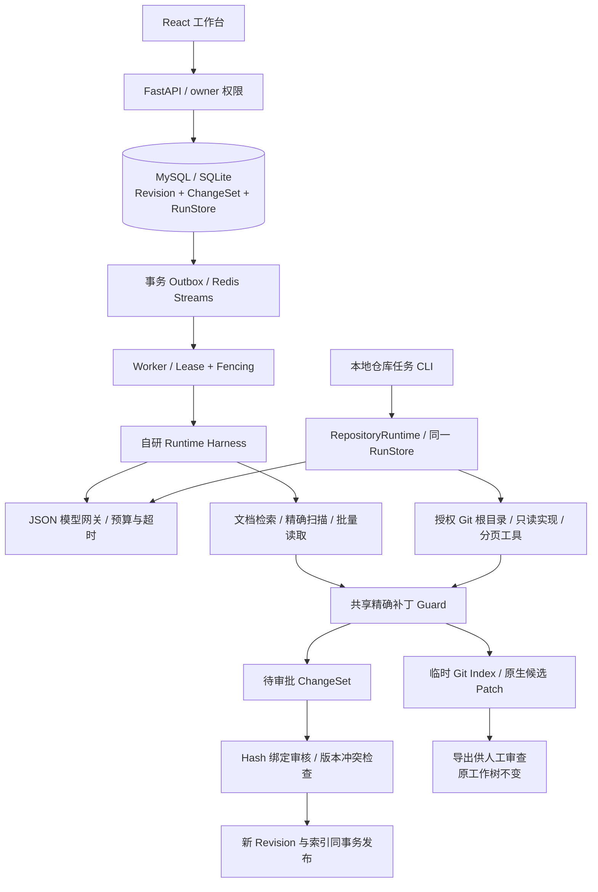

# DocChange V0.2：仓库任务与公开评测

日期：2026-11-02。本设计补充 10/11/13/14 的持久执行与权限约束，不替换原后端。原 ShopResolve 代码保留；文档域是当前应用主线。

2026-11-03后续：工作台新增可选语义检索，详见[设计19](19-DocChange语义检索与配对评测.md)与[全量对照报告](../evaluation/docchange-retrieval-improvement-2026-11-03.md)。下文公开基线协议与仓库适配范围保留，不将检索新成绩混算成DoGBench新成绩。

## 业务边界

用户面对的是“实现变更以后，哪些说明过期、哪些文档应修改、修改依据能否审查”的维护任务。输入是任务、当前文档与只读实现参考；输出是待审核 ChangeSet 或 Git patch。系统不执行代码示例、不安装依赖，不承担通用代码开发。

有两种输入规模：工作台把小型授权文档集导入版本快照；仓库适配器保留已有 Git 目录，按需列举、检索和分页读取，避免把整仓一次塞进模型。两者共享结构化 Edit 和确定性修改 guard，以及 SQL RunStore；不把二者的存储、发布能力混为一谈。

## 组件与数据流

本机一键入口以数据库持久轮询代替 Redis，生产式 Worker 路径仍使用已有 Outbox/Streams。MySQL、Redis 是已有实现的技术栈；本轮本机评测使用隔离 SQLite，不把它称作 MySQL/Redis 实机压测。

### 异步边界

文档任务 API 返回202与run_id，由后台 Worker 驱动模型循环。网关使用异步HTTP客户端，SQLAlchemy和Redis使用异步驱动；Redis Worker将任务执行和租约心跳作为独立协程。Dispatcher在SQL事务外发送Redis消息，失败时可以重发通知，SQL状态和租约仍是执行依据。

单个Worker进程逐项处理队列任务，可以多进程消费；当前不引入同进程并行处理或新的消息中间件。网页演示采用独立持久轮询协程；其能力不等同于Redis部署。仓库文件/Git操作经`asyncio.to_thread`执行；工作台检索在SQL会话关闭后同样卸载计算，不将线程持有数据库session。

有依赖的工具调用与审批发布仍保持顺序。`read_many`是一次决策读取多个文件，不宣称文件并行加速。小工作区候选索引仍在发布前完整生成，随正文在同一事务切换，没有新增异步索引服务或索引一致性窗口。

## Agent 与执行控制

- 单 Agent 根据结构化工具观察决定下一步，框架侧保存模型响应、工具调用身份、结果和检查点。没有新增多 Agent、跨会话长期记忆或任意 Shell 工具。
- 读取、查询、提案是不同动作；已有目标须先读取。`replace` 校验原文与精确出现次数；`create` 必须是未占用的文档路径；`delete` 仍要求已有目标已读取。工作台另要求新路径在 `creatable_paths` 授权中。
- 工作台的任务合同包含 `editable_paths`、`required_absent`、`required_present`，作为确定性可检查后置条件；它们不能证明自然语言语义正确。
- 仓库只读工具禁止绝对路径、越界解析、`.git`、符号链接及非文档写入。实现参考可读取，不可被补丁修改。仅控制器运行固定 Git 命令，模型不能提供命令字符串。
- 仓库候选使用独立临时 Git index 生成 patch，运行 `git apply --check`；不把模型输出直接应用到用户工作树。大仓库的网页审核、原子 Git 提交/推送不是此适配器已实现的能力。
- 解析失败不抢救执行写动作；有限协议反馈仍计入总轮次。模型请求与任务均有限额和超时。持久响应在恢复后复用，读取证据与路径授权随检查点保存。
- SQL 是运行状态事实源；租约/fencing 保护框架状态和工作台发布。仓库导出只产生候选工件，不扩展公开执行端点。

## 两种隔离

工作台保留原 Docker Sandbox Manager 的可选固定文档检查。当前 Docker Engine 不可用，不能写成本轮真实 Docker 检查通过。

公开仓库评测使用 API 工具白名单隔离：模型只产生 JSON 动作，可信工具层读取指定快照，不提供宿主命令、网络或任意文件入口。它不是 DoGBench 原生 CLI Agent 的 Docker/网络代理隔离。官方源码参考中的测试符号链接保留原状，但读取工具不能沿其访问根目录外的文件。

## 公开评测协议

检索组件使用完整 BEIR SciFact test300、SCIDOCS test1000，保留原文档单位和相关性标注；使用项目实际 BM25 tokenizer、TREC scorer。它不测跨文档修改，也不测最终回答可信度。没有 Dense/Rerank 比较，因此没有“混合检索提升”的结论。

文档维护使用 DoGBench 公开 development175：123 个需改任务、52 个应弃答任务。117 个私有任务未取得，不能写成292题全量。冻结公开任务、prompt、树与代码 blob；候选侧不读取 outcome、rubric、人工补丁、原 PR 或真实提交历史。评分侧读取官方 rubric，复用原始 Terra prompt、Schema、证据校验和数值规则。

兼容改动逐项披露：HTTPX 完整响应/同站重定向、可信 Git 对象缓存、同 GitHub repository ID 的旧名绑定；精确发布输入中的 prose-overlap finding 保留但允许 API 适配执行；参考符号链接采用工具层不可遍历政策，保留原文件树。原始严格准入结果与兼容结果分别记录。不能声称这是未修改官方协议的排行榜成绩。

裁判仍为 `gpt-5.6-terra` / high；CLI 改成 read-only、关闭插件与工具、最多两次评分尝试，取代上游默认绕过沙箱/最多20次重试。无效裁判输出须显式缺失，不能伪造成零分。有效的执行错误、轮次耗尽、错误弃答则按官方规则计零分。

完整逐题结果、失败归因和简历可用口径在 `docs/evaluation/docchange-public-2026-11-02.md`。该文件给出的实际结果优先于任何设计预期。
