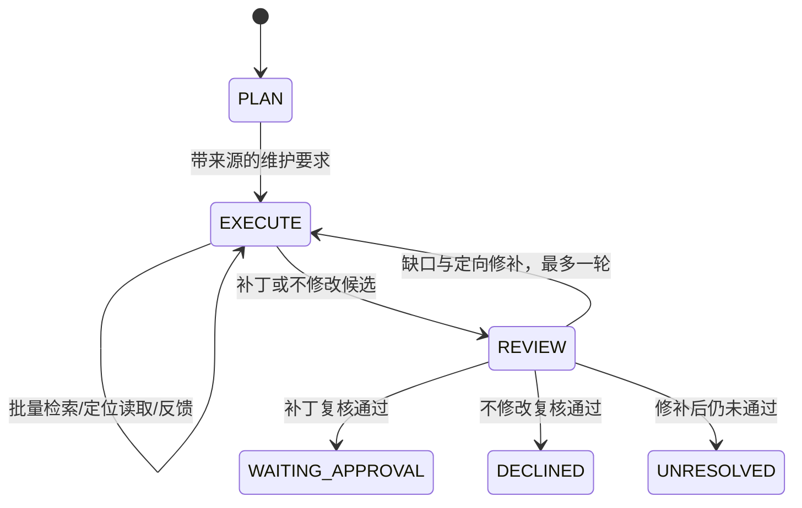

# 覆盖驱动仓库维护：冻结范围

2026-11-03。用户授权完成本轮架构修改、最终公开评测和私有仓库交付。本轮结束后不因成绩继续增加功能或反复调参。

## 保留的边界

保留 FastAPI、SQL RunStore、Outbox、Redis Streams、Revision/ChangeSet、人工审批与自研工具循环。网页小文档集仍使用 DocumentRuntime；开放仓库维护使用 RepositoryRuntime。下述策略默认在仓库 CLI 与最终 DoGBench 候选中开启，不把它说成所有网页请求都已采用相同策略。

## 状态与执行

Requirements 保存 id、description、evidence_ids。任务与实现 diff 摘要各有稳定来源 ID；模型生成的要求是待核实判断，不是官方答案。逐 edit 关联 requirement_ids/evidence_ids，并保留已有原文范围、精确匹配、后缀和路径 Guard。框架校验关联存在，不声称仅凭 ID 就证明语义正确。

Reviewer 通过单独请求和独立上下文执行，输入原始任务、实现摘要、要求、实际候选和可用原文，不提供作者完整探索轨迹或自我论证。它必须逐项报告 covered/no_change/missing，可指出原计划遗漏的新要求和无依据表述。不修改候选也须复核；证据不足不能直接等同无需修改。Reviewer 与作者可使用同一 Pro 模型，错误不保证独立，最终仍需人工审核。

计划、候选、覆盖结果、修补次数和阶段随 Checkpoint 持久化。复用已保存模型响应和工具回执；恢复不增加已有工具副作用。第一次复核拒绝后最多修补一轮；之后仍不通过则明确 UNRESOLVED，保留草稿供诊断，不自动批准或发布。所有阶段计入同一 16 次模型决策预算，独立复核不是额外无限预算。

## 检索与上下文

默认章节 BM25/Dense RRF 混合检索，搜索提供路径、标题、精确原文范围和引用 ID；代码参考仍走词法检索。批量查询与每文件独立定位读取已实现。首次索引构建在接受模型运行之前完成，预热结果清除，不能授权修改。按模型/runtime/provider/文本哈希复用向量，避免重复编码相同版本片段。

上下文保留显式任务状态和阅读清单；过大的单个历史观察不会阻止其余可容纳观察进入上下文。Reviewer 的原文片段有明确截断标识，未提供完整文档的证据不能解释为已完成完整语义核验。未实现 GraphRAG、多 Agent 编排、训练式检索或跨会话长期记忆。

## 冻结评测

既有 SciFact300/SCIDOCS1000 和旧 DoGBench175 成绩原样保留。仓库定位诊断覆盖123个需修改任务；110题有支持格式的人工路径标签，102题有当前快照可检索标签，13题无适用路径标签。报告五种方法与两种分母；这是定位代理，不是 Agent 综合质量。

最终候选使用 DeepSeek Pro/high、章节混合检索和本策略；仅访问冻结公开任务与授权代码/文档。官方 outcome、rubric、人工路径不进入 Planner、工具或 Reviewer。结果不得写成独立 held-out 成绩，也不得把模型、工具、策略共同变化的差值归因给单一组件。未做三组完整消融，不声称已证明每个新增模块的独立贡献。

费用使用现有账户余额和持久账本，不充值、不租卡。预算不足的未执行项标为实验未完成，不冒充 Agent 失败或计零分；正常进入任务后的执行错误按原评分规则保留。175题同时包含需修改与无需修改两类，只有完整评分后才报告新的综合分。冻结后不按结果删除题目、重新选择高分输出或继续改策略。
