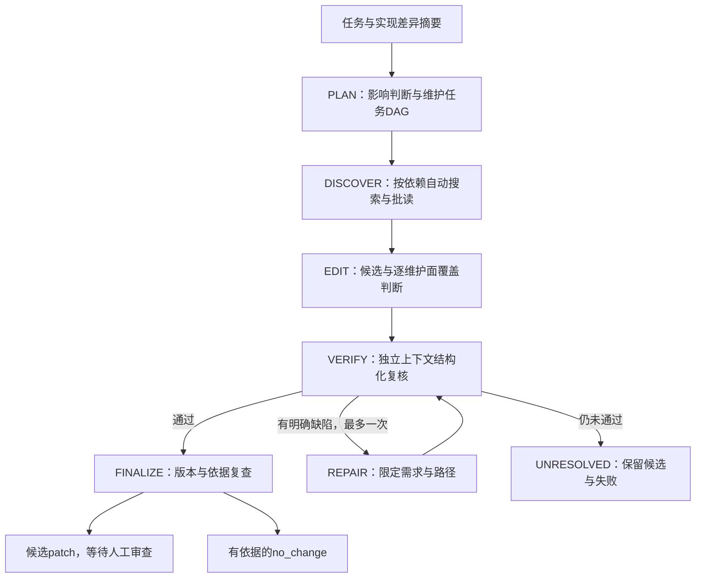

# DocChange：任务图与证据关系维护策略

2026-11-17。策略名`taskgraph-v2`。本轮替换仓库任务的执行策略，不重写网页、后端或检索器。

## 为什么改执行层

原Pro同49题有21项轮次耗尽、13项超时；Flash放宽时间和轮次后仍有12项轮次耗尽、11项覆盖复核失败。原计划只保存要求，每次搜索和读取仍依赖新的模型决策。这支持优先验证“可执行计划能否减少探索决策”的假设，但不能证明失败全部由该原因造成；复核失败也可能是真实遗漏，不直接称为误拒。

## 实际状态机

PLAN合并影响分析与任务分解，EDIT合并覆盖判断与候选生成。正常链路包含3次模型请求，单轮修补后最多5次，这是无协议/工具错误的结构路径，**不是公开任务平均调用数**。模型承担Planner、Editor、Reviewer三个角色；自动工具调度不称为多个LLM Agent。

## 执行计划与调度

`MaintenanceTask`继承Requirement，增加依赖、维护面、文档/实现查询与路径提示。计划检查重复ID、未知依赖和环；稳定Kahn分层，同层最多3个发现任务并发。每节点搜索后读取最多2个文档文件和2个实现文件，每次最多120行；这是工具资源边界，不能解释为完整仓库已覆盖。

检索沿用RepositoryEnvironment/BM25/BGE/RRF。共享索引初始化和搜索串行保护，读取可并发；不宣称向量推理并行加速。节点工具调用经原RunStore保存幂等回执，自动搜索/批读不预留ModelStep。恢复时重放缓存回执并还原已观察范围，不重新调用模型调度同一读取。

## 证据关系与覆盖矩阵

证据保存原文范围、内容哈希、来源根目录、路径、Git版本、触发工具/查询及所属维护任务。节点包括Requirement、Evidence、Coverage、Edit、Review；关系包括依赖、检索用途、来源引用、编辑关联与复核。它是可导出的JSON关系图，**不是GraphRAG或图数据库**。

每个`requirement × surface`必须有一条覆盖判断：`edit_required`、`no_change_supported`或`unresolved`。已解决格需要真实仓库观察，不能只引用用户任务ID；既有文件编辑必须引用该路径的观察，并关联对应覆盖格。没有检索结果不能直接推成无需修改。

`ImpactAssessment`是模型判断，记录`public_change/internal_only/uncertain`和依据。内部变化或已经完整写入文档的公开变化都可能无需修改；影响仍不确定则不能交付no_change。no_change仍独立复核，外部旧协议导出`abstain`并附`semantic_decision=no_change`；未解决任务以UNRESOLVED失败，不混成弃答成功。

## 结构化上下文与复核

编辑输入按任务选择少量片段并标记截断；完整原文留在检查点。复核只看到原任务、影响判断、计划、发现结果、候选和候选引用的证据，不拼作者完整观察轨迹。引用证据保留完整已读取内容，不再固定只取最近16个、每个1600字符；全部引用超过输入预算时明确报CONTEXT_LIMIT，不暗中丢弃引用。

缺陷类型：MissingEvidence、WrongTarget、UnsupportedEdit、OutdatedReference、IncompleteCoverage、VersionConflict。Reviewer指出已有任务/维护面，Repair只能调整缺陷涉及的需求与路径，其他候选编辑须保留；最多一轮，然后独立复核。当前限定到需求/文件，**未实现任意语义span级修补或自动新增任务重规划**。

最后检查Git HEAD与已观察原文范围，阻止依据或版本变化后的交付。临时Git Index和`git apply --check`沿用原适配器，源工作树不被候选改写。证据引用和模型复核都不能证明语义正确，patch仍需人工审查。

## 与现有应用的关系

网页小文档集仍走DocumentRuntime，以Revision/ChangeSet审批发布；仓库策略通过独立CLI导出patch，未新增网页审批后自动提交Git的功能。FastAPI、SQL Outbox、Redis Streams、Lease/Fencing、Checkpoint、检索权重与历史成绩保留。

`run_repository`默认新策略，可传`--policy coverage-v1`复现旧入口。DoGBench控制器新增`--repository-policy taskgraph-v2`，默认仍是coverage-v1，避免静默改变历史协议；新策略必须使用新的输出目录与冻结计划。

## 借鉴来源

参考[qiqihezh/deepresearch-agent固定版本的DAG设计](https://github.com/qiqihezh/deepresearch-agent/blob/3c59892d459c95a747166cd3c9573093c0794109/src/planner/dag.py)，借鉴依赖分层、有界调度与显式状态模式。本轮按DocChange现有回执/租约机制独立实现，没有复制或导入上游整套运行时；Kahn拓扑排序是通用算法，不作为原创算法。没有搬入其压缩、语义记忆、自进化或作者实验成绩。

## 当前证据与后续

验收覆盖DAG与并发、3请求正常链路、无依据阻断、结构化修补、源版本变化、引用保留，以及读取回执落盘后进程退出的恢复，见[本轮验收](../evaluation/docchange-taskgraph-2026-11-17.md)。本轮不运行付费模型评测，原检索和维护成绩不能归因于新策略。

后续先用固定49题、相同Flash模型/检索/32决策预算比较coverage-v1与taskgraph-v2；统计最终质量、无修改召回、未解决比例、实际模型请求和工具数量，保留全部失败，独立Judge评价最终输出。只有明确改善后再考虑完整175题；不先假设DAG必然提高质量。
