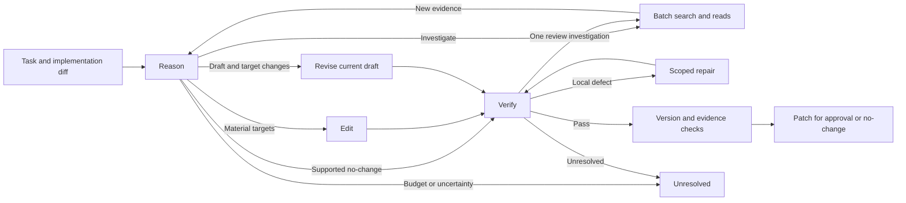

# 仓库维护的批量 ReAct 策略

2026-11-18。新策略 `batched-react-v1` 运行在原有仓库工具和持久 Harness 上。静态 `taskgraph-v2` 仍可通过 CLI 显式选择，已跑完的 H4 基线对应提交 `ec79aa5`。

H4 在开发用的固定 49 题中有 41 题未解、5 题校验失败，返回 3 个最终决定，其中 1 个方向正确。症状支持让新观察改变下一步调查。这个分布无法单独证明规划遗漏、检索不足、模型判断和规则门槛各占多少，也无法证明新策略会改善质量。

一次模型决策提交至多四个本轮问题。执行器对可访问的文档和代码根发起有界搜索，根据排名和精确路径选择读取。无效路径提示会从可继续搜索的分支中移除，查询仍然执行。同轮并发执行搜索，再以稳定顺序分配读取，每个问题最多读取三个文档路径或两个实现路径，每次最多 120 行。跨轮按实际读到的区间去重，后续命中同一文件的新片段时可以补读。

每轮调查保存问题、查询、实际读取范围、检索排名、观察编号和新增证据数。控制器在收到观察后决定继续调查、提交材料支持的交付目标、提出无需修改的结论或返回未解。`no_change` 必须同时引用观察到的文档与实现材料，后者可以是代码片段，也可以是有实际内容的实现差异。实现与文档两侧是否真正支持结论由复核判断。

初稿之前最多三轮调查，复核单独保留一轮补查。总上限为十次模型决策（含协议纠错）和一次局部修补。复核补查后，`REASON` 接收当前草稿和交付目标、复核问题与新证据。`REVISE` 只提交编辑增量，由运行时保留既有编辑。删除或替换旧编辑需要指明编辑 ID，取消交付目标需要引用新证据。重新验证合并结果后才能进入下一次复核。重复研究意图和后续回合无新证据仍会结束调查，调度和工具回执随持久检查点恢复。

编辑器提交具体编辑、相关交付目标和观察编号，运行时生成覆盖记录。复核上下文以精确编辑操作呈现候选，省去重复的 unified diff。上下文超限时优先移除额外挑战片段，再为引文生成精确编辑锚点或明确标示的局部摘录，保留原始来源 ID、快照、哈希及字符区间。原始观察保留在检查点。编辑锚点和候选仍超限时返回上下文错误。局部修补会把被点名的共享编辑作为整体替换并保留其目标绑定，同一文件里的其他编辑也可保留。最终候选需通过 Git 应用检查、观察跨度及版本验证，才能进入人工审批。

Git 临时索引与候选 blob 存在同一个临时目录，源对象库只读参与补丁计算。这样候选生成不会再给已封存的基准仓库留下不可达对象。

模型模式是独立实验变量。Flash 的架构对照使用非思考模式。`--batched-thinking` 单独在推理与复核开启思考。开发用 49 题分别做历史 `32 vs 10` 系统对照，以及两组均为 10 次决策上限的同预算对照，详见[公开评测复现说明](../PUBLIC_BENCHMARK_RUNBOOK.md)。报告按题配对，并记录方向正确率、补丁质量、正确 no-change、未解原因、调查轮数、时延、调用量和 token。其余 126 题曾进入历史 175 题评测，属于已使用的公开题目。
