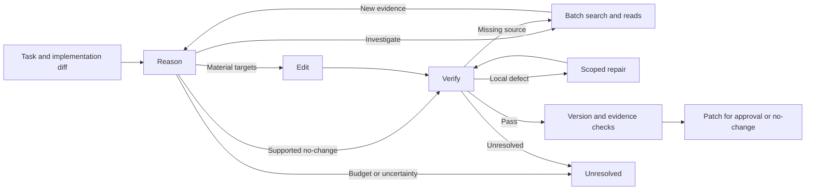

# 仓库维护的批量 ReAct 策略

2026-11-18。新策略 `batched-react-v1` 运行在原有仓库工具和持久 Harness 上。静态 `taskgraph-v2` 仍可通过 CLI 显式选择，已跑完的 H4 基线对应提交 `ec79aa5`。

H4 在开发用的固定 49 题中有 41 题未解、5 题校验失败，返回 3 个最终决定，其中 1 个方向正确。症状支持让新观察改变下一步调查。这个分布无法单独证明规划遗漏、检索不足、模型判断和规则门槛各占多少，也无法证明新策略会改善质量。

一次模型决策提交至多四个本轮问题。执行器对可访问的文档和代码根发起有界搜索，根据排名和精确路径选择读取，累计读过的路径或锚点会去重。同轮并发执行搜索，再以稳定顺序分配读取，每个问题最多读取三个文档路径或两个实现路径，每次最多 120 行。原检索器仍按自身排序返回片段。读取旧文件的另一个具体范围可以提供新的观察。

每轮调查保存问题、查询、尝试读取的范围、检索排名、观察编号和新增证据数。首轮假设不绑定最终交付。控制器在收到观察后决定继续调查、提交需要编辑的实际目标、提供有依据的无需修改结论或返回未解。最多三轮调查、十次模型决策（含协议纠错）、一次局部修补。重复研究意图或后续回合没有新证据时停止。持久化研究调度和既有工具回执用于中断恢复。

编辑器提交具体编辑、相关交付目标和发现的原文编号，运行时生成覆盖记录。有实际目标却缺少编辑的候选必须纠错或退出。独立复核读取候选引用和最多六个不同路径的候选外片段。额外片段按上下文容量退让，候选引用不静默截断。复核可提交一轮新调查，或限定需求与路径做局部修补。最终候选需通过已有 Git 应用检查、观察跨度及版本验证，进入人工审批。

Git 临时索引与候选 blob 存在同一个临时目录，源对象库只读参与补丁计算。这样候选生成不会再给已封存的基准仓库留下不可达对象。

模型模式是独立实验变量。Flash 的架构对照使用非思考模式。`--batched-thinking` 单独在推理与复核开启思考，编辑和修补禁用。调用数和每轮路径数是当前工程上限，与模型质量成绩分开记录。后续在同一开发 49 题比较方向正确率、质量、正确 no-change、未解原因、调查轮数、时延、调用量和 token，再用提前冻结的独立评测集判断能否推广。其余 126 题曾进入历史 175 题评测，不能称为从未接触的盲测集。
