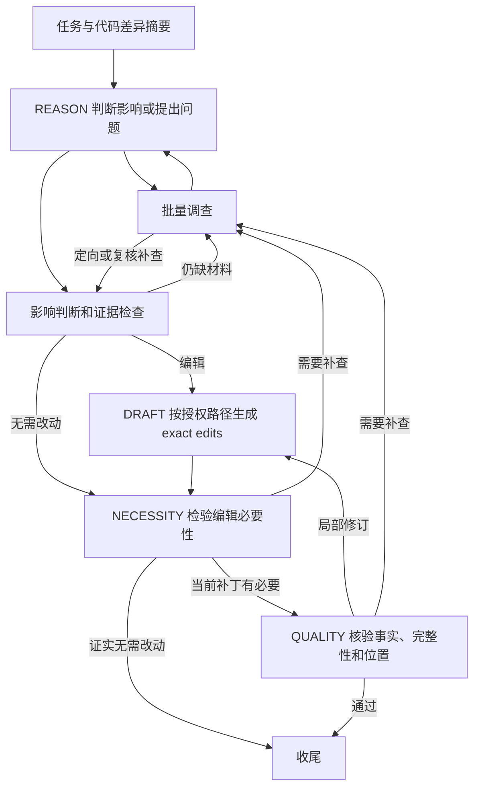

# DocChange 仓库维护架构

## 实测依据

上一版 Full Belief 可评分的 30 题中，9 题耗尽协议纠错，8 题在影响核验时缺证据，7 题发生 Windows 睡眠恢复相关的租约错误。旧 Batched ReAct 的 244 次请求记录了 76,190 个输出 token，Full Belief 的 121 次请求记录了 424,421 个。后者已记录的思考 token 为 325,707，占已记录输出约 76.7%。按包含未知用量请求的总请求数计算，已知输出约从 312 增至 3,508 token/请求。提示、选择性思考和编排同时改变，实验无法把增幅归因到某一项。上次账本按高峰费率估算并保留未知用量额度，用户回报实际扣费为四块多。

## 运行流程

- 复用原有 Git 差异摘要，第一轮 REASON 根据任务和差异判断调查方向。简单题在看过证据后可以直接提出影响决定，省去固定的单独总结模型调用。确需补证时进入 IMPACT，取得新证据后可重判。
- 模型输出研究问题、路径和简短理由，以及支撑判断所需的证据 ID。运行时为已批准路径分配目标 ID，保留各路径状态、支持与反证引用、未决问题、证据原文与定位、访问过的区间、批次历史、候选补丁和决策历史。全部随 RunStore 检查点持久化。
- 研究预算分为初查 2 轮、影响定向调查 2 轮、复核调查 1 轮。优先调查可能改变需改与否、补丁范围或复核结论的问题。确定性编辑补读单独计数，模型纠错与编辑重试均包含在单题 12 次请求上限内。
- 影响判断核查路径和证据来源。已有目标缺原文时定向读取。无需改动仍需要实现与文档两侧证据。新文档需要相关文档证据，并由 Git 层验证新增操作。模型输出的路径、置信度和理由无法授予编辑权限。
- 编辑器只获取批准路径、任务要求、原文和必要证据。每份补丁单独做必要性判断，允许撤销。随后做质量复核，以原任务、实现、未使用的高排名观察、已记录反证和查找覆盖挑战补丁。增量修订限于授权路径，保留其他路径的旧编辑；变更后的补丁重新检查必要性和质量。
- 格式恢复处理完整的 JSON 代码围栏、动作大小写和已知别名、机械字段冗余、问题与查询超量。遇到多个决策对象、重复 JSON 字段、缺失事实、未知枚举或无效证据时，校验拒绝，按阶段最多请求一次纠错。编辑匹配失败会先按目标补读；现有补丁、原始模型输出与预算凭据均保留。
- 临时 Git 索引、封存快照核对、范围和原文检查继续守住补丁交付。Windows 全量入口在启动时申请进程内防休眠，结束即释放。租约失效时通过 RunStore 尝试一次重新认领，沿用检查点和已用预算。后续持有者优先，单题截止时间仍有效，供应商已接收但尚未持久化的请求可能要重试。

## 冻结配置与下一轮评测

策略标识为 `ledger-react-v1`。第一轮统一使用 Flash 非思考。语义阶段输出上限 1,536 token，补丁编辑阶段为 4,096 token。冲突时开启思考或切换 Pro 留作单独对照，避免混入首轮策略验收。

1. 固定之前选定的 24 道方向失败题和 6 道低质量正确题，运行一次开发回归。题集从旧版结果预先选择，保留所有终态。用原评分器分别核验方向、交付质量与 P0 clean，记录两种复核的补查、撤稿和修订轨迹。
2. 以全部 30 道预定题为工程检查分母。终态协议失败率目标小于 2%，在这个样本中即要求 0 道。没有终态的题不能用来通过准入；租约、模型传输、证据不足和协议耗尽分别报告。0/30 是样本观察，无法证明总体错误率低于 2%。
3. 对比请求量和各阶段输入、输出、思考 token 与未知用量，记录实际扣费以用户可核对的账单为准。回归通过后，再用同一策略、模型、输入和评分配置从头覆盖全部 175 题，回归工件保留。历史 49 题可作同题诊断；只有本轮同一版本全量完成并评分后才报告 175 题综合分。这 175 题属于历史公开基准。
4. 将原 `batched-react-v1` 作为历史对照，并记录决策上限差异。若要隔离架构收益，再以相同模型、思考设置、请求上限和题目跑配对对照。单独记录宿主中断，避免把睡眠时间解释为正常任务耗时。
