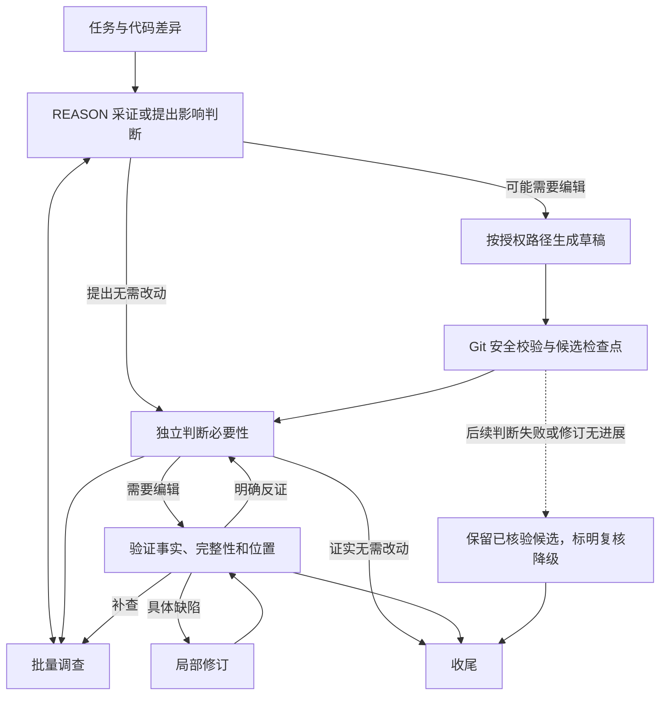

# DocChange Proposal-First 仓库维护架构

## 实测依据

上一版 Ledger ReAct 的 30 题回归救回 10/24 道方向失败题，原方向正确的 6 题全部退化。六题里，两题耗尽质量复核格式纠错，一题修订空转，一题错误弃答，一题在推理阶段证据不足，一题止于影响核验。取消独立 IMPACT 可以减少出稿门槛，但只能针对这批退化中的一条路径。方向正确的 5 个补丁都存在 P0 问题，质量仍需实测。

## 主流程

1. **提案条件。** 合法文档路径、可追溯的实现与文档证据和受影响理由即可启动草稿。已有路径缺原文由运行时定向读取。拟新建文件使用同目录文档或上级导航、约定文档作为支持。运行时核验路径、版本、原文范围与 Git 补丁可应用性并分配目标 ID；语义上的修改必要性进入复核。
2. **全局预算。** Flash 各阶段关闭思考。最多 12 次模型请求，包含纠错和重试。初稿前保留一轮出稿与两轮复核。复核补查共享剩余决策，确定性补读与 Git 操作不计模型请求。修订前保留一轮出稿与一轮复核。
3. **宽输入。** 去除代码围栏，接受已知动作别名，忽略无关字段与元数据，截断超量研究问题和查询。严格拒绝动作冲突、重复 JSON 字段、缺失必要操作、未知引用和越权编辑。原文编辑始终验证准确匹配。
4. **反向质疑。** 必要性复核读取任务、实现、当前文档、候选、搜索覆盖与独立证据。稳定的同范围修订直接回到 QUALITY。新增范围或必要性反证触发独立判断。QUALITY 输出可定位的具体缺陷、证据 ID 或待查问题。运行时保留不在修订范围内的编辑。
5. **候选保留。** 首份合法且有正向证据的草稿随检查点保存。后续补丁通过质量检查时替换；同范围补丁若经复核剩余缺陷更少，也可成为保留版本。复核协议耗尽、证据仍不充分、局部修订越权或空转时回到保留版本，并标记 `unavailable` 或 `degraded`。已尝试的缺陷按路径和规范化文字记账，避免在同一问题上轮转。降级仍要重新检查来源和 `git apply --check`，最终补丁待人工审批。权限、版本或检查点失效时停止交付。合法候选的检查点只说明草稿有来源且可应用；语义正确性仍由复核和人工审批确认。
6. **严格撤稿。** 普通无需改动要求实现与文档证据及明确的无缺口理由。已有补丁要撤销，必须另列两侧反证，覆盖相关路径，并至少包含一处超出草稿已引用区间的仓库观察。运行时核验引用、来源类型和范围，审查模型判断这些材料是否真正推翻缺口。证据不足时可以补查或保留已有候选。

## 下一轮 30 题门槛

策略标识为 `proposal-react-v1`。复用已锁定的 24 道历史失败题与 6 道旧方向正确题。扩展前需要完整运行并评分 30 道，且同时达到历史失败题至少 10/24、旧方向正确题保留至少 5/6、终态协议失败 0/30。继续核验原有传输、精确编辑和租约要求。复核不可用但保留补丁要单独计数，并与经过完整复核的补丁一同进入原评分器。P0-clean、补丁质量、补丁召回、正确弃答和实际扣费均单列；未设 P0 数值门槛。样本结果只用于开发决策，未验证 175 题表现。
